<p align="center">
  <a href="LICENSE"></a>
  
  
  
  
  
  <a href="https://github.com/Wglly/GF-shell/stargazers"></a>
  <a href="https://github.com/Wglly/GF-shell/commits/main"></a>
</p>

<p align="center">
  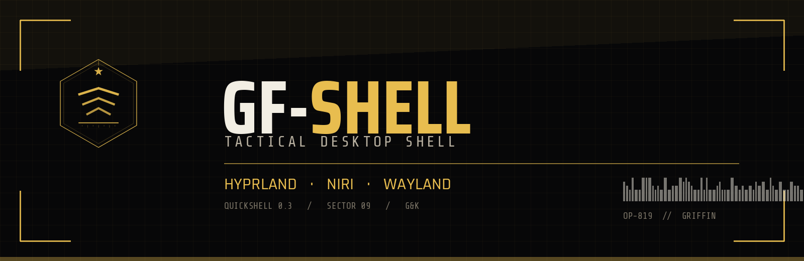
</p>

<h1 align="center">GF-shell</h1>

<p align="center"><b><i>少女前線</i>風の Quickshell デスクトップシェル · Hyprland / niri · Wayland</b></p>

<p align="center">
  <a href="README.md">繁體中文</a> · <a href="README.zh-CN.md">简体中文</a> · <a href="README.en.md">English</a> · <a href="README.ja.md">日本語</a>
</p>


GF-shell は Quickshell（Qt Quick）で一から書かれたデスクトップシェルです。ビジュアルは『少女前線』の
公開されている戦術 UI に着想を得ています — 暖かいチャコール、マットゴールドのアクセント、45° の
小さな面取り、金の細線＋内側の白線による二重枠、斜めのラベルリボン、ハーフトーンドット、
セグメント式ゲージ、等幅のデータ書体。
壁紙・エンブレム・テクスチャ・アイコン背景などの画像素材はすべて `scripts/gen_assets.py` が
プログラムで生成しており、**ゲームの原本素材は一切含みません**。

ドキュメント：[インストール](docs/INSTALL.ja.md) · [設定](docs/CONFIG.ja.md) · [アーキテクチャ](docs/ARCHITECTURE.ja.md) · [デザイン](docs/DESIGN.ja.md) · [進捗](docs/PROGRESS.en.md) · [すべての言語](docs/i18n.md)

---

## 目次

- [機能](#機能)
- [スクリーンショット](#スクリーンショット)
- [必要環境](#必要環境)
- [インストール](#インストール)
- [インストール](#インストール)
- [自動起動](#自動起動)
- [キーバインドと > 注意：`SUPER+Tab` は他のシェル（MC-shell など）が使用している場合があります。本プロジェクトは `SUPER+ALT+Tab` を使います。
> 効かない場合は `hyprctl globalshortcuts | grep gf-shell` に `gf-shell:overview` があるか、
> 同じキーを二重にバインドしていないか確認してください（二重だと開いてすぐ閉じます）。

IPC](#キーバインドと-ipc)
- [設定](#設定)
- [ディレクトリ構成](#ディレクトリ構成)
- [カスタマイズとテーマ](#カスタマイズとテーマ)
- [アセット生成](#アセット生成)
- [2 つのコンポジタへの対応](#2-つのコンポジタへの対応)
- [既知の制限](#既知の制限)
- [ライセンスとクレジット](#ライセンスとクレジット)

---

## 機能

| モジュール | 内容 |
| --- | --- |
| **ステータスバー (Bar)** | テーマ別の展開ターミナル（テーマごとの紋章と指揮表記、プリセット名は表示しない）、オペレーター入口、エシュロン／ワークスペース番号、アクティブウィンドウのタイトル、中央時計、メディア、CPU／メモリ、ネットワーク、Bluetooth、音量、バッテリー、展開式トレイ（アイコン＋最近のメッセージ）、壁紙ライブラリ、作戦マップ／戦術コントロール／システム停止への入口。狭い画面では副次ブロックを自動的に隠します。「設定 → ステータスバー → コンポーネント」の end-4pc 風ボードで、チップを左／中央／右へドラッグして並べ替え、OFF で非表示にできます。ネットワーク／Bluetooth／パフォーマンスは独立したブロックで、クリックすると詳細が開きます。ネットワーク詳細には付近の Wi-Fi 一覧が表示されます。 |
| **デプロイ端末 (Launcher)** | 全画面のユニット一覧。カテゴリ（すべて／最近／通信／開発／メディア／オフィス／戦闘／システム）、あいまい検索、キーボード操作、右側のユニット情報（CLASS／STATUS／SOURCE／EXEC）と DEPLOY ボタン。展開後のタイトル、指揮サブタイトル、円形メダルは現在のテーマの紋章に切り替わります。マウスホイール／ドラッグでスクロールできます。 |
| **ダッシュボード** | macOS Launchpad 風の全画面一覧。テーマ別タイトル、システム／電力／リンク／メディアの 4 枚のカード、ユニット検索、アプリグリッド、SETTINGS／CONTROL／MAP／LAUNCHER ショートカット。GFL／Arknights／BF4／BF1 でタイトル・背景・カード輪郭が変わります。 |
| **戦術コントロール (Control Center)** | リンク状態（Wi-Fi／Bluetooth）、音量・亮度のセグメントスライダー、モジュールスイッチ、CPU／MEM／BAT のセグメントゲージ、通知履歴、メディア操作。バーポップアップ（`popupKind=control`）として開くため、デスクトップウィジェットは表示されたままです。 |
| **作戦マップ (Overview)** | ワークスペースごとに 1 枚の「セクター」カードを表示し、その中のユニットを一覧。セクターをクリックでワークスペース移動、ユニットをクリックでそのウィンドウにフォーカス。ユニットを別セクターへドラッグするか、右クリックして対象セクターをクリックするとウィンドウを移動できます。 |
| **コマンドローズ** | **デスクトップ右クリック**で《Battlefield》の Q コマンド風ホイールを表示：設定、壁紙、ウィジェット配置、デプロイ端末、ネットワーク、ターミナル、ダッシュボード。クリックまたは 1–7 で選択、左クリック／Esc で閉じます。GFL／Arknights／BF4／BF1／HoI4 で中心バッジ・リング・背景が異なります。HoI4 は参謀コンパス、四方向の刻み、HIGH COMMAND / NATIONAL ORDERS の表記を使います。 |
| **システム停止 (Power)** | ロック／サスペンド／再起動／シャットダウン／ログアウト。危険な操作は 2 回目の確認が必要（ENTER 2 回）、ESC でキャンセル。 |
| **HUD ウィジェット** | 大型時計、システムバイタル、通信（歌詞つき）、天気、cava オーディオスペクトル、オペレーターカード、現在の任務。個別にオン／オフ可能。**デスクトップレイアウト編集**ではグリッドを重ね、ドラッグで移動、右下角でリサイズできます。編集ツールバーで **全体の透明度** と **ウィジェット線の透明度** を調整できます。 |
| **エシュロン (Dock)** | 固定済みと実行中のユニットを順に表示（上限 12）。実行中のアプリは自動追加。設定 → Dock でアプリ名を入力して固定できます。ユニットを右クリックすると固定／解除、新しいウィンドウ、閉じるを選べます。`dock.position` は上／下／左／右に対応。左右では **縦型サイド Dock** になり、`dock.align` が縦の上／中央／下（または横の左／中央／右）を決めます。自動非表示が有効なときだけ隠れ、Dock が接している画面端の 6px エッジにポインタが来ると展開して exclusive zone でウィンドウを押し出します。アイコンサイズ／透明度／グレースケール／ブラー、収納マージン（0–240px）を調整できます。**ウィンドウ回避をオフ**にすると Dock は常に表示され、非表示時は 6px のエッジ線だけになります。バーと同じ辺にある場合も、6px のエッジ線だけが表示されます。 |
| **通知** | 右上の「通信」トースト（スライドイン、7 秒で自動消去、クリックで閉じる）と、コントロールセンター内の履歴。 |
| **OSD** | 音量／亮度の HUD。セグメントゲージと大きな数値表示。 |
| **カレンダー** | 時計をクリックすると開くスケジュールパネル。月移動、今日のハイライト、週番号。 |
| **副官設定 (Settings)** | すべてのテーマで DAYLIGHT の紙白コンソール（白い紙、黒い罫線、チャコールのボタン）を使い、アクセント、ホバー／選択、セクション表示、スライダーだけを各テーマの強調色にします。背景は **透明度・グレーを調整できるグレーホワイトの半透明**。8 つのタブ（外観／ステータスバー／エシュロン／サイドバー／ウィジェット／壁紙／システム／情報）。**ダーク／ライト／カスタム配色**、**全体スケール**と**フォントスケール**に対応。最初のページにオペレーターホーム（アバター、ユーザー／システム情報、クイック操作）を追加。システムタブで Hyprland／niri のギャップ、枠線、角丸、アニメーションを調整できます。外観タブではローカル `fc-list` フォントから UI／見出し／データ／ラベルのフォント、ローカル Xcursor ポインターのテーマとサイズを選択できます。設定行もフォントに合わせて拡大します。 |
| **サイドバー** | 左：オペレーター情報、カレンダー、分隊名簿。右：メディア＋歌詞＋cava スペクトル＋通知ログ。左右画面の**上端または下端**のホットゾーンで開き、幅・高さ・位置を設定で調整できます。ポインタが離れると遅延して閉じます。幅／透明度／グレースケール／ブラーを調整可能。コンポーネントはバーと同じドラッグボードで、左／右へドラッグして並べ替え、OFF へドロップして非表示にできます。高さ（40–100%）と上下中央の整列も調整できます。壁紙コンポーネントも含みます。 |
| **バーポップアップ** | オペレーター・時計・メディアをクリックすると、そのブロックの位置に詳細パネルが開きます（ユーザー／カレンダー／メディアは独立）。 |

その他：

- 9 つのテーマプリセット：**G&K STANDARD**、**SANGVIS FERRI**、**NEURAL CLOUD**、**ARCTIC OPS**、**RHODES ISLAND (Arknights)**、**BATTLEFIELD 4**、**BATTLEFIELD 1**、**HEARTS OF IRON IV**、**DAYLIGHT OPS**（ライト、ニュートラルグレー）。DARK / LIGHT / CUSTOM を選び、BG0/BG1/PANEL/TEXT/ACCENT を 16 進カラーで指定できます。ゲームテーマはそのテーマ内だけに背景サイン、バー／Dock のディテール、ダッシュボードの外観を追加します。HoI4 は「NATIONAL ARCHIVES / FOREIGN OFFICE」サイドバー、ローマ数字の戦域タブ、参謀地図のデスクトップ枠、真鍮の二重罫線、NATIONAL SITUATION REPORT の題字を追加します。ユーザーカード（バーのユーザーポップアップ、サイドバーのオペレーターファイル、デスクトップのオペレーターカード）はテーマごとに切り替わります。HoI4 は国家指導者の肖像＋政治力／安定度／戦争支持、BF4／BF1 は軍衔背景付きの兵士ファイルと服務記録、Arknights はロドス島のオペレーターファイル＋クラス／レアリティ／信頼です。デスクトップ概要（OPERATION MAP）を開いたときの地図背景もテーマごとに切り替わります：HoI4 は真鍮色のメルカトル世界図、BF1 はヨーロッパ戦線図、BF4 は全球ネットワーク図、Arknights はテラ／ロードス島測量図、GFL は世界戦域図。他のテーマでは読み込まれません。BF1 の角丸半径（0–28px）、全体アニメーション速度（0.5×〜2.0×）、全体ライン透明度（0〜1）は設定 → 外観 → サーフェスで調整できます。
- 全体スケールは `SHELL SCALE`（全体）と `FONT SCALE`（文字と展開パネル／カードのレイアウト）に分離。設定画面のベールは透明度とグレーを調整できます。
- アイコンフォントを 1 つに統一（Material Symbols のサブセットを *GF Tactical Icons* に改名、約 1 MB、システムフォントとの衝突を回避）。テキストフォント 4 種を同梱（Chakra Petch / Saira Condensed / Rajdhani / Share Tech Mono）。
- UI は **繁體中文 / 简体中文 / English / 日本語** の 4 言語対応。設定 → システム → 言語で即時切替できます（設定画面自体も翻訳されます）。
- 壁紙は内蔵 4 枚＋**ディレクトリ取り込み**（png/jpg/webp/avif を自動認識）。バーとサイドバーに壁紙ライブラリがあり、全画像を一覧できます。
- ライトテーマでは壁紙に紙白の色を重ねません。
- バー／Dock／サイドバーは **透明度・グレースケール・ブラー・サイズ・位置・外枠線の太さ／透明度** を調整可能。ブラーは壁紙サンプリングのシェーダーで、コンポジタのブラーに依存しません。
- メディアカード（バーポップアップ／サイドバー／デスクトップ）は歌詞（lrclib.net）と cava スペクトルを共有します。
- グローバルな状態機械により、同時に表示されるオーバーレイは常に 1 つだけ。
- IPC を内蔵：`qs -c gf-shell ipc call shell toggle <overlay>`（niri／スクリプト／キーバインドから利用）。

---

## スクリーンショット

| デプロイ端末 | 戦術コントロール |
| --- | --- |
|  |  |

| 作戦マップ | システム停止 |
| --- | --- |
|  | 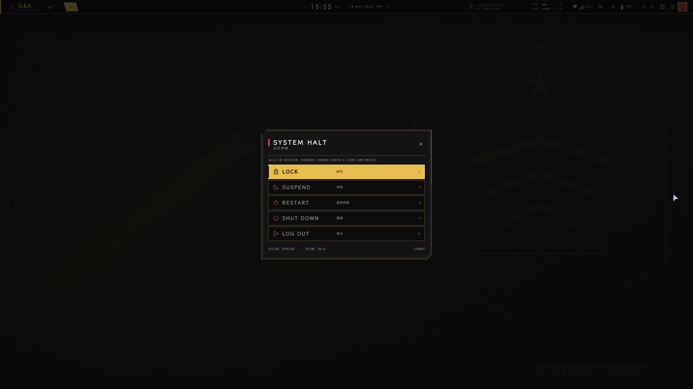 |

| 副官設定 | 壁紙 |
| --- | --- |
|  |  |

| カレンダーのポップアップ | OSD | 通知 |
| --- | --- | --- |
|  |  |  |

| 左サイドバー | 右サイドバー |
| --- | --- |
|  |  |

| English インターフェース | 日本語インターフェース | 日本語サイドバー |
| --- | --- | --- |
|  |  |  |

| バーコンポーネント編集 | サイドバーコンポーネント編集 | デスクトップグリッド |
| --- | --- | --- |
|  |  | 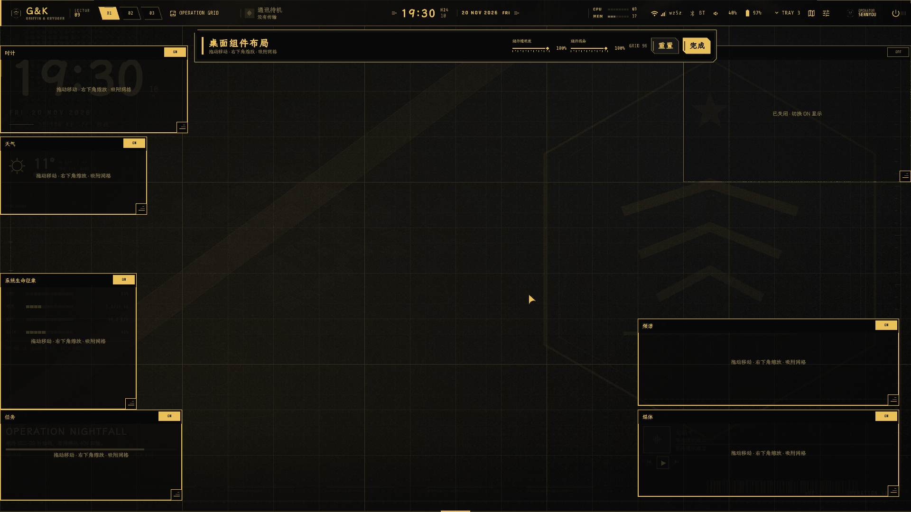 |

| ライトテーマ：デスクトップ | ライトテーマ：ランチャー | 設定：スケールと表面 |
| --- | --- | --- |
| 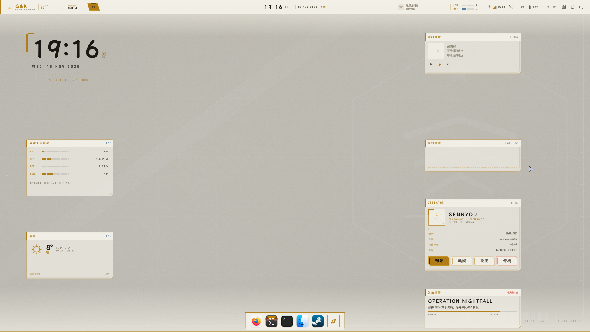 | 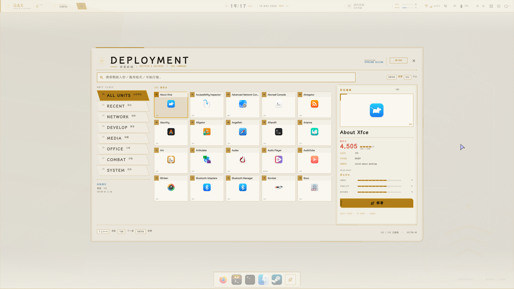 | 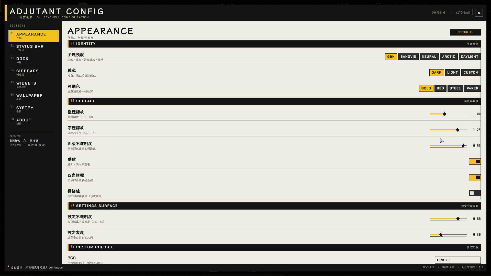 |

| Network details & nearby Wi-Fi | Bluetooth details | Performance details |
| --- | --- | --- |
| 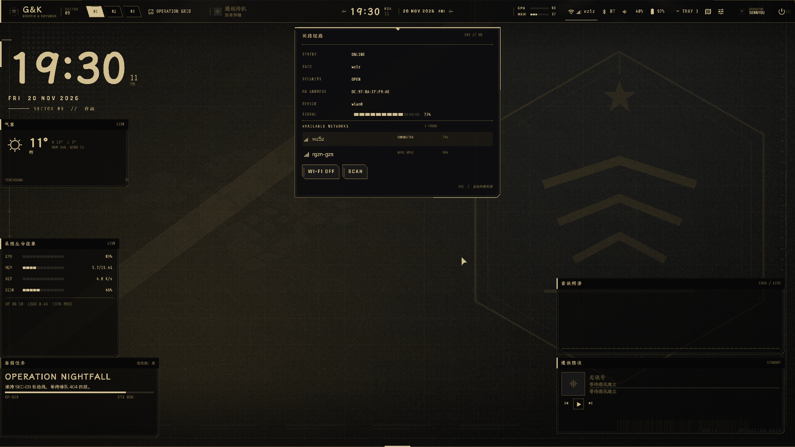 | 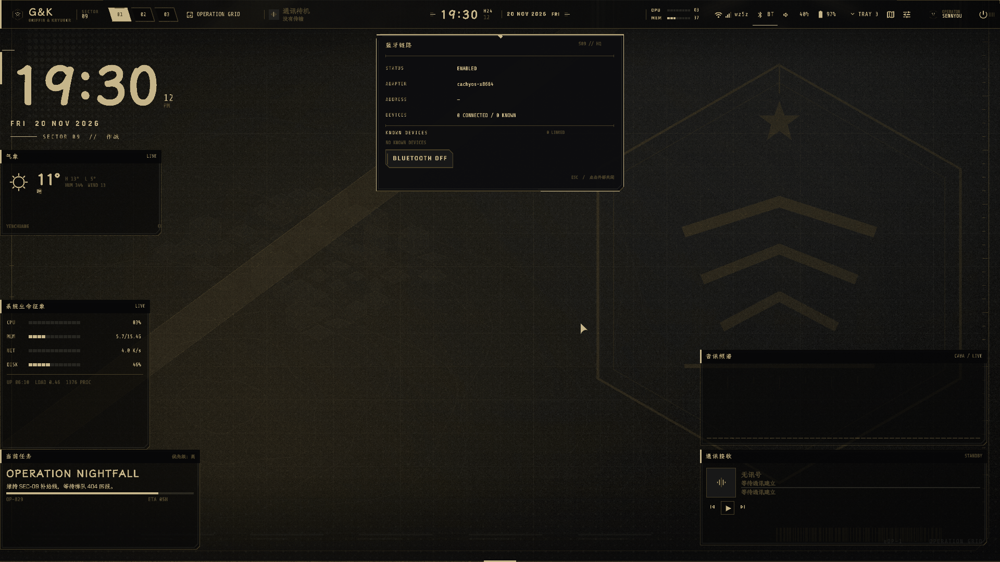 | 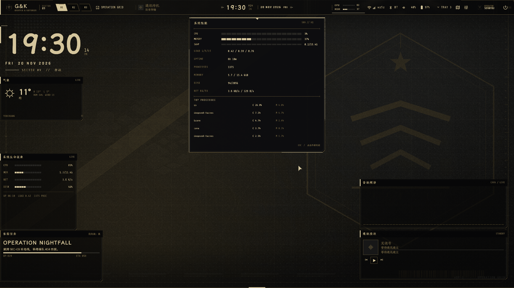 |

| Settings home / avatar | Wallpaper library | Expandable tray |
| --- | --- | --- |
| 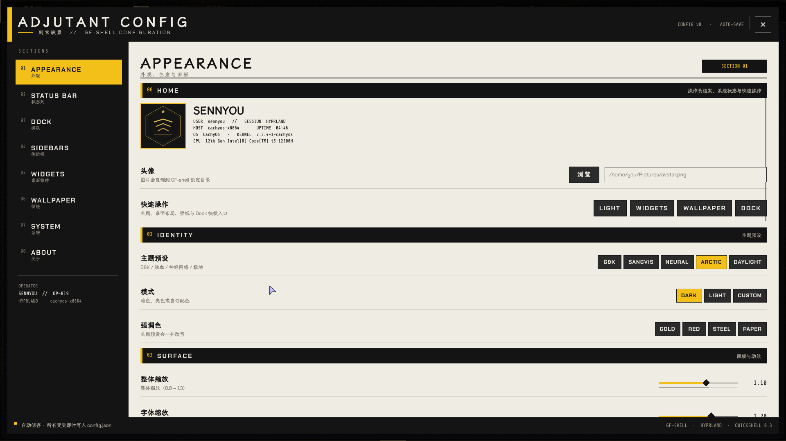 | 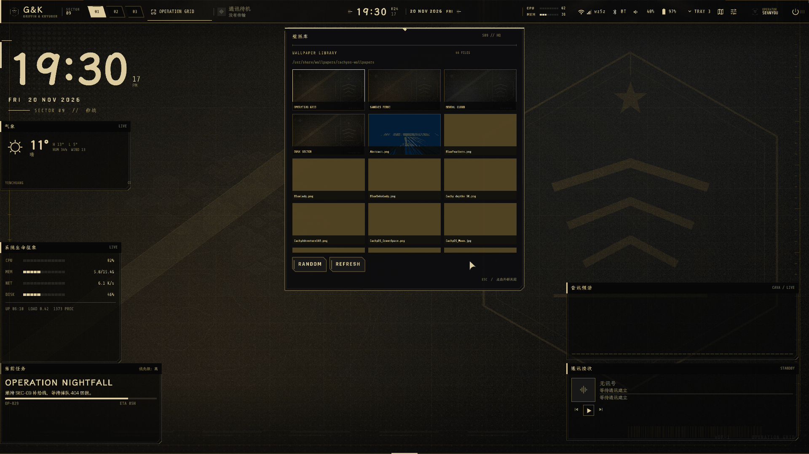 | 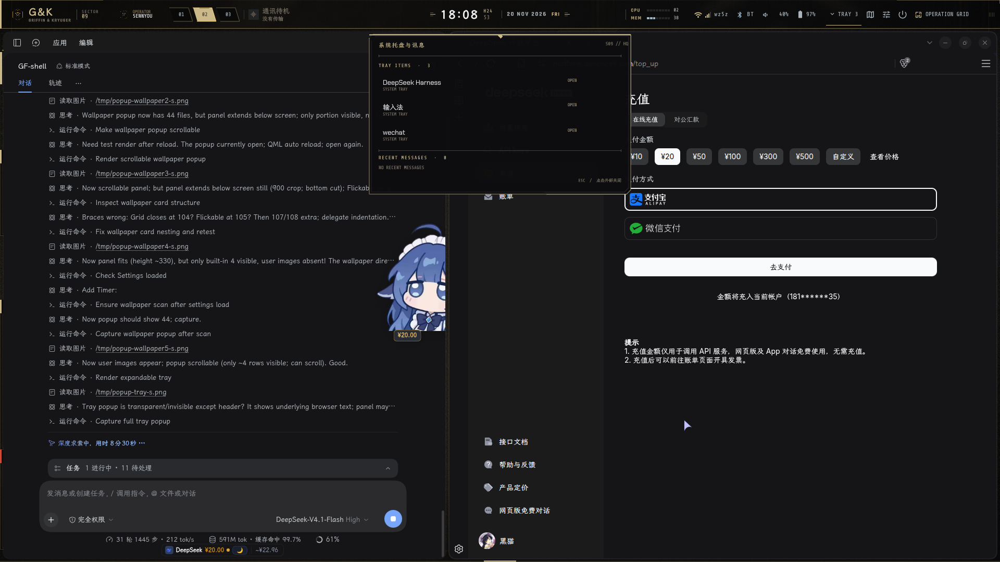 |

| Dashboard | Command rose (GFL) | Command rose (BF4) |
| --- | --- | --- |
| 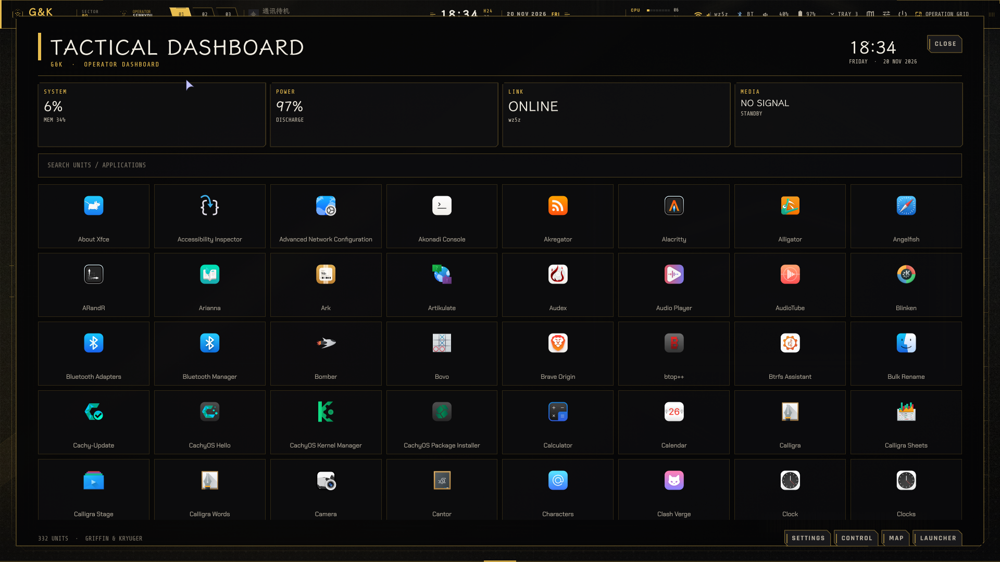 | 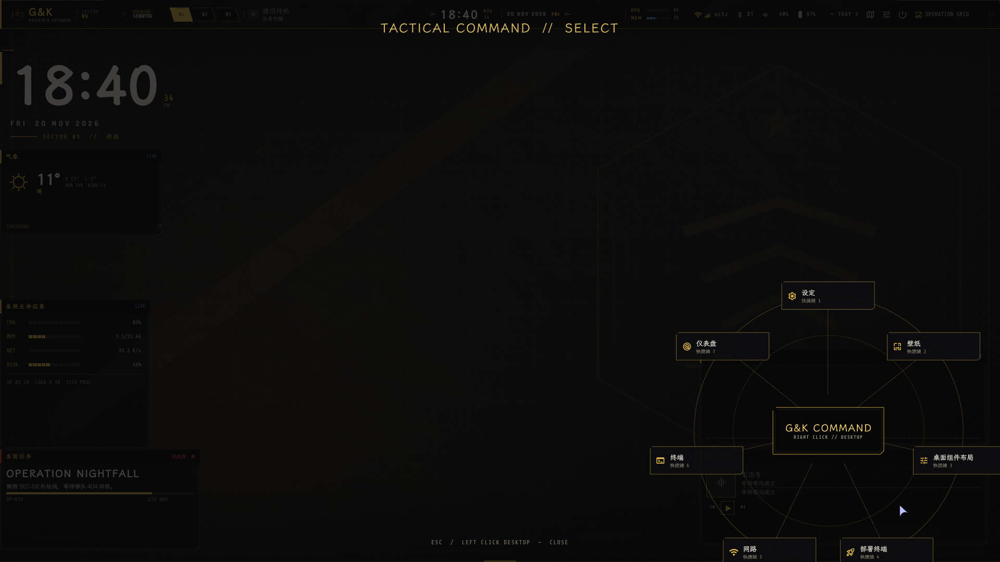 | 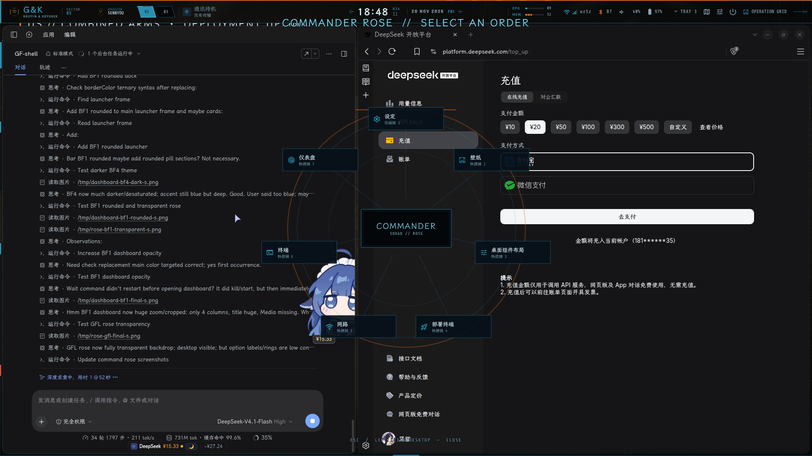 |

| Command rose (Arknights) | Command rose (BF1) | Vertical dock |
| --- | --- | --- |
| 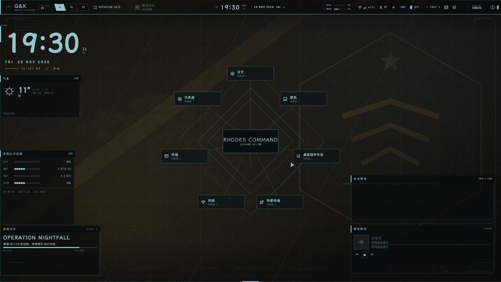 | 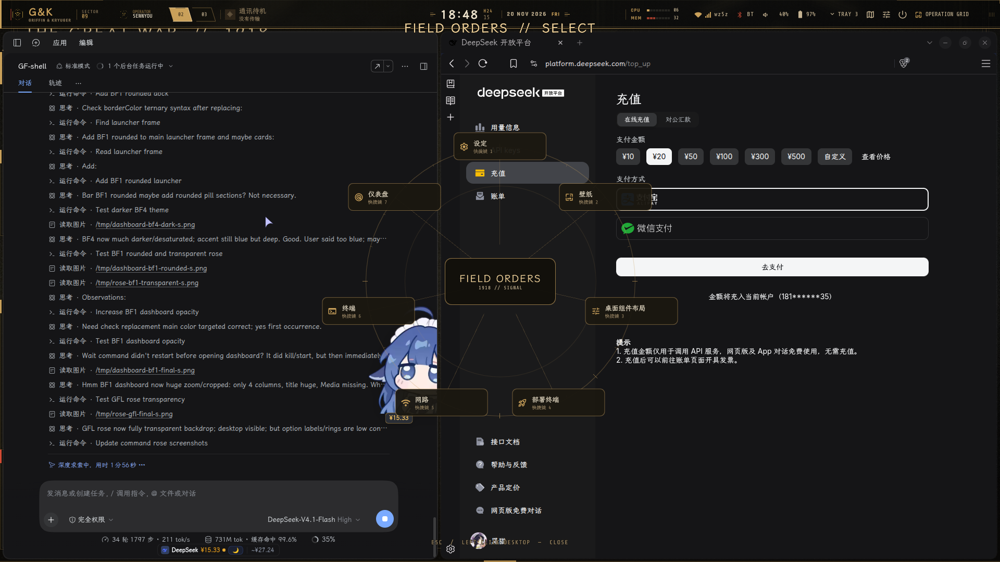 | 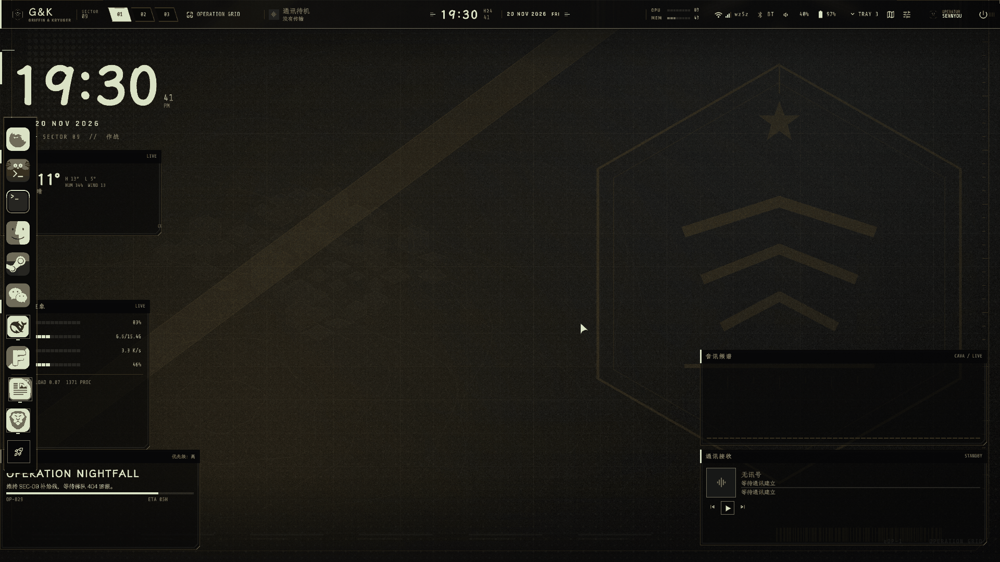 |

| Dock deploy chooser | | |
| --- | --- | --- |
| 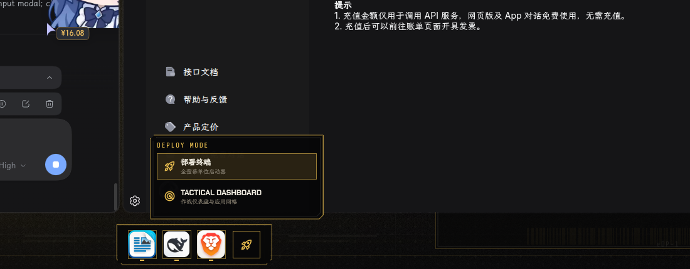 | | |


同じシェルを **niri** 上で実行した様子（Hyprland 内にネストしたウィンドウ）：


---

## 必要環境

- **Quickshell ≥ 0.3**（Arch: `quickshell`、Fedora: COPR、Debian 13: `trixie-backports`）
- Qt 6：`qt6-declarative`、`qt6-svg`、`qt6-wayland`、`qt6-base`
- Wayland コンポジタ：**Hyprland** または **niri**（両方で動作確認済み）
- 推奨ツール（無い場合、対応機能は自動的に無効になります）：
  - `pipewire` + `wireplumber`：音量
  - `brightnessctl`：亮度
  - `NetworkManager`：ネットワーク切替／SSID
  - `bluez`：Bluetooth 切替
  - `upower`：バッテリー
  - `cava`：オーディオスペクトル
  - `curl`：天気（wttr.in）と歌詞（lrclib.net）
  - `grim` / `slurp` / `wf-recorder`：スクリーンショットと録画
  - `wl-clipboard`：スクリーンショットのコピー
- フォント：ラテン文字・アイコンは同梱（`assets/fonts/`）。CJK はシステムの `Noto Sans CJK` を使用。

---

## インストール

```bash
git clone <repo> GF-shell           # またはこのディレクトリをそのまま使用
cd GF-shell

# Fedora / Nobara / RHEL 系（依存関係 + COPR）
./scripts/install-fedora.sh

# Debian / Ubuntu（Debian 13 は backports。apt に無ければ --build-quickshell）
./scripts/install-debian.sh

# Arch / 汎用
./install.sh                        # ~/.config/quickshell/gf-shell にコピー
# 開発用：
./install.sh --link                 # シンボリックリンク（編集が即反映）

qs -c gf-shell                      # 起動
```

インストールせずにパス指定で実行することもできます：

```bash
qs -p /path/to/GF-shell
```

アンインストール：

```bash
rm -rf ~/.config/quickshell/gf-shell
rm -rf ~/.config/gf-shell
```

### 自動起動

**Hyprland**（Lua 設定、0.5x）：

```lua
hl.exec_cmd("qs -c gf-shell")
```

**Hyprland**（従来の `hyprland.conf`）：

```ini
exec-once = qs -c gf-shell
```

**niri**（`~/.config/niri/config.kdl`）：

```kdl
spawn-at-startup "qs" "-c" "gf-shell"
```

> 既に別のシェル（end4-pC / caelestia / waybar など）を使っている場合は、先にその自動起動と
> バーを無効にしてください。そうしないとバーが 2 本重なります。

---

## キーバインドと IPC

シェルは appid `gf-shell` で Hyprland のグローバルショートカットを登録します。以下を Hyprland の
設定に追加してください：

```lua
-- Hyprland 0.57 の Lua 設定
hl.bind("SUPER + Space",      hl.dsp.global("gf-shell:launcher"),  { description = "GF-shell: デプロイ端末" })
hl.bind("SUPER + ALT + TAB",  hl.dsp.global("gf-shell:overview"),  { description = "GF-shell: 作戦マップ" })
hl.bind("SUPER + SHIFT + TAB", hl.dsp.global("gf-shell:overview"), { description = "GF-shell: overview (alt)" })
hl.bind("SUPER + SHIFT + C",  hl.dsp.global("gf-shell:control"),   { description = "GF-shell: 戦術コントロール" })
hl.bind("SUPER + SHIFT + P",  hl.dsp.global("gf-shell:power"),     { description = "GF-shell: システム停止" })
hl.bind("PRINT",              hl.dsp.global("gf-shell:screenshot"),{ description = "GF-shell: スクリーンショット" })
```

従来の設定：

```ini
bind = SUPER, Space, global, gf-shell:launcher
bind = SUPER ALT, TAB, global, gf-shell:overview
bind = SUPER SHIFT, TAB, global, gf-shell:overview
bind = SUPER SHIFT, C, global, gf-shell:control
bind = SUPER SHIFT, P, global, gf-shell:power
bind = SUPER SHIFT, W, global, gf-shell:widgets
bind = , Print, global, gf-shell:screenshot
```

**niri** は Hyprland のグローバルショートカットプロトコルに対応していないため、IPC を使います：

```kdl
Mod+Space { spawn "qs" "-c" "gf-shell" "ipc" "call" "shell" "toggle" "launcher"; }
Mod+Alt+Tab { spawn "qs" "-c" "gf-shell" "ipc" "call" "shell" "toggle" "overview"; }
Mod+Shift+Tab { spawn "qs" "-c" "gf-shell" "ipc" "call" "shell" "toggle" "overview"; }
Mod+Shift+W { spawn "qs" "-c" "gf-shell" "ipc" "call" "shell" "widgets"; }
```

IPC インターフェース（`IpcHandler`、ターゲット `shell`）：

```bash
qs -c gf-shell ipc call shell toggle launcher    # none|launcher|control|overview|power|settings|calendar
qs -c gf-shell ipc call shell open overview
qs -c gf-shell ipc call shell close
qs -c gf-shell ipc call shell widgets   # デスクトップレイアウト編集
qs -c gf-shell ipc call shell volume 0.7   # 音量設定
qs -c gf-shell ipc call shell mute         # ミュート切替
qs -c gf-shell ipc call shell status
```

| オーバーレイ | `GF_OVERLAY` の値 | 用途 |
| --- | --- | --- |
| デプロイ端末 | `launcher` | アプリの検索／起動 |
| 戦術コントロール | `control` | リンク、音量、亮度、通知 |
| 作戦マップ | `overview` | ワークスペースとウィンドウ |
| システム停止 | `power` | 電源操作 |
| 副官設定 | `settings` | 設定ウィンドウ |
| カレンダー | `calendar` | スケジュール |

> デバッグ用環境変数：`GF_OVERLAY=<overlay>` で起動時にオーバーレイを開く、`GF_TAB=<0-7>` で設定タブを
> 指定、`GF_DEBUG=osd|toast|gauge|icons` で対応するデバッグ画面（`modules/debug/`）を表示。

---

## 設定

設定ファイル：`~/.config/gf-shell/config.json`（初回起動時に自動生成）。

| セクション | 主なキー |
| --- | --- |
| `bar` | `position`、`thickness`、`opacity`、`gray`、`blur`、`clock24h`、`showSeconds`、`left` / `center` / `right`（ブロック順。設定で OFF/LEFT/CENTER/RIGHT） |
| `sidebar` | `left`/`right` の `width`、`height`（0.4–1.0）、`align`、`opacity`、`gray`、`blur`、`assign.<id>`（left/right/off） |
| `theme` | `preset`（`light` を含む）、`mode`（dark/light/custom）、`accent`、`accent2`、`bg0`、`bg1`、`panel`、`text`、`fontScale`、`settingsOpacity`、`settingsGray`、`scale`、`animations` |
| `wallpaper` | `enabled`、`path`（`file://` または空＝内蔵）、`fillMode`、`dim` |
| `dock` | `enabled`、`autoHide`、`avoid`、`iconSize`、`opacity`、`gray`、`blur`、`maxItems`、`pinned` |
| `widgets` | `grid`（吸着ピクセル）と各ウィジェットの `enabled`・`x`・`y`・`width`・`height`（レイアウト編集の右下でリサイズ） |
| `overview` | `columns`、`desktops`、`backdrop` |
| `notifications` | `dnd`、`toasts`、`maxToasts` |
| `osd` | `enabled` |
| `language` | `auto` / `zh_TW` / `zh_CN` / `en` / `ja` |

`bar.left/center/right` で使用できるブロック：

```
launcher | emblem | user | workspaces | title | clock | media | stats | net | bluetooth | volume
| battery | tray | overview | control | power
```

すべて「副官設定」から変更でき、設定は即座に書き込まれます。

---

## ディレクトリ構成

```
GF-shell/
├── shell.qml                    # エントリ：フォント、テーマバインディング、ショートカット、画面ごとのウィンドウ、IPC
├── install.sh
├── scripts/gen_assets.py        # 壁紙 / エンブレム / テクスチャ生成器（Pillow + numpy）
├── assets/
│   ├── fonts/                   # Chakra Petch、Saira Condensed、Rajdhani、Share Tech Mono、GFTacticalIcons
│   ├── icons/                   # emblem*.png（生成）
│   ├── textures/                # halftone / hatch / noise / scanlines
│   └── wallpapers/              # gfl-ops / gfl-sangvis / gfl-neural / gfl-dusk
├── services/                    # シングルトンのサービス層
│   ├── Compositor.qml           # Hyprland + niri 共通のワークスペース／ウィンドウ API
│   ├── Settings.qml             # config.json の読み書き、テーマプリセット
│   ├── Audio / Battery / Net / Media / Notifs / Stats / System / Apps / Capture
│   ├── I18n.qml                 # 英語 / 繁体字中国語の文字列
│   └── Wallpapers.qml
├── modules/
│   ├── common/                  # Theme.qml、ShellState.qml、Util.qml
│   │   └── widgets/             # Gf* デザインシステム：Frame / Button / Slider / Toggle / Gauge…
│   ├── bar/                     # ステータスバー、ブロック、カレンダー
│   ├── launcher/                # デプロイ端末
│   ├── control/                 # 戦術コントロール
│   ├── overview/                # 作戦マップ
│   ├── power/                   # システム停止
│   ├── widgets/                 # デスクトップ HUD
│   ├── dock/                    # エシュロン
│   ├── notifications/           # 通信トースト
│   ├── osd/                     # 音量／亮度 HUD
│   ├── wallpaper/               # デスクトップ背景レイヤ
│   ├── settings/                # 副官設定
│   └── debug/                   # GF_DEBUG 用デバッグページ
└── docs/                        # インストール、設定、アーキテクチャ、スクリーンショット
```

**データフロー**：`services/*` がシステム状態（Quickshell の Pipewire／UPower／Mpris／Networking／
SystemTray、`hyprctl` / `niri msg`）を購読します。`modules/common/Theme.qml` が唯一のデザイントークン
の出所で、UI は `Theme.*` とサービスの読み取り専用プロパティだけを参照。状態は `ShellState.qml`、
書き込みは `Settings.qml` を通します。

---

## カスタマイズとテーマ

- **色／間隔／文字サイズ**：`modules/common/Theme.qml` だけを変更します。
- **テーマプリセット**：`services/Settings.qml` の `presets`、または設定画面から切り替え。
- **ステータスバーにブロックを追加**：
  1. `modules/bar/blocks/` に `FooBlock.qml` を作成；
  2. `modules/bar/BarItem.qml` の `switch` に `foo` を追加；
  3. 設定の `bar.left/center/right` に `"foo"` を追加。
- **オーバーレイを追加**：`PanelWindow`（`WlrLayer.Overlay`）を作成 →
  `ShellState.overlay === "name"` で表示 → `shell.qml` でインスタンス化。`IpcHandler` と
  `GlobalShortcut` は任意の名前に対応しています。
- **壁紙の変更**：設定画面から選ぶか、画像パスを `wallpaper.path` に書き込みます。公式画像は同梱していません（[デザインノート](docs/DESIGN.ja.md)）。

---

## アセット生成

```bash
python3 scripts/gen_assets.py
```

`Pillow` と `numpy` が必要です。以下を再生成します：

- `assets/wallpapers/*.png`（1920×1080：暖かいチャコール、金の斜め帯、ハーフトーンドット、等高線、アイソメトリック基地線画、エンブレム透かし、細い金枠）
- `assets/icons/emblem*.png`、`assets/icon.png`
- `assets/textures/*.png`

**エンブレムはオリジナルデザイン**（六角形の枠＋三段の翼形シェブロン＋コマンドスター）です。
『少女前線』の公式マークではありません。

---

## 2 つのコンポジタへの対応

`services/Compositor.qml` が両者の違いを 1 つの API にまとめます（`workspaces`、`windows`、
`focusedId`、`windowTitle`、`focusWorkspace()`、`focusWindow()`、`step()`）：

- **Hyprland**：Quickshell の `Quickshell.Hyprland` サービスを使用（イベント駆動）。
  Hyprland 0.5x の **Lua 設定**にも対応（`Hyprland.usingLua` が真なら `hl.dsp.*` でディスパッチ）。
- **niri**：Quickshell 0.3.x には niri サービスが無いため、`niri msg --json` で問い合わせ、
  `niri msg event-stream` を変更シグナルとして使用。3 秒の低頻度ポーリングとイベントストリームの
  再接続を保険として持たせています。
- 検出順：`NIRI_SOCKET` を優先（niri が Hyprland 内にネストされている場合は両方が存在）、
  次に `HYPRLAND_INSTANCE_SIGNATURE`。

---

## 既知の制限

- **niri**：Hyprland のグローバルショートカットプロトコルに非対応。`GlobalShortcut` は Hyprland でのみ
  動作します。niri では IPC でバインドしてください。
- **ブラー**：コンポジタの blur は使いません（パネルは半透明＋スキャンライン）。どのコンポジタでも
  同じ見た目になり、性能への影響もありません。
- **通知**：`org.freedesktop.Notifications` は同時に 1 つしか存在できません。他のシェルが保持して
  いる場合、GF-shell の通知サーバはそれが終了してから引き継ぎます。
- **マルチモニタ**：ステータスバー、デスクトップ HUD、エシュロンは画面ごとに 1 つずつ生成されます。
  全画面オーバーレイは現在フォーカスされている画面に作成されます。
- **トレイ**：一部アプリの StatusNotifierItem アイコンは規格に沿っておらず、点のプレースホルダに
  なります。
- **スクリーンショット**：`grim`（Wayland）に依存。録画は `wf-recorder` を使用します。

---

## ライセンスとクレジット

- コード：MIT（`LICENSE` を参照）。
- 同梱フォント：SIL Open Font License 1.1（Chakra Petch、Saira Condensed、Rajdhani、Share Tech Mono）と
  Apache License 2.0（Material Symbols Rounded）。詳細は `assets/fonts/LICENSES.md`。
- ビジュアルは『少女前線』の**公開されているインターフェースのスタイル**へのオマージュであり、
  再解釈です。本プロジェクトはゲームの原本アート、ロゴ、フォントを一切含まず、配布もしません。
- アーキテクチャは、ローカルの end4-pC（end-4 dots-hyprland の Quickshell 移植）と一般的な
  Quickshell シェルのサービス構成を参考にしていますが、UI とアセットはすべて本プロジェクトで
  新規に作成／生成したものです。
