<p align="center">
  <a href="LICENSE"></a>
  
  
  
  
  
  <a href="https://github.com/Wglly/GF-shell/stargazers"></a>
  <a href="https://github.com/Wglly/GF-shell/commits/main"></a>
</p>

<p align="center">
  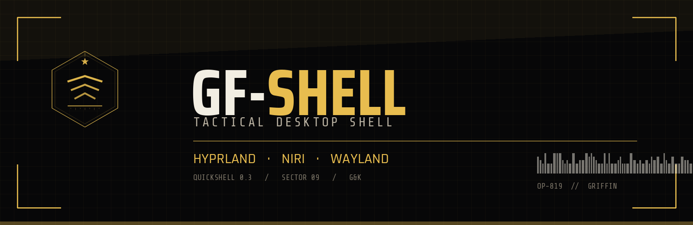
</p>

<h1 align="center">GF-shell</h1>

<p align="center"><b>《少女前線》風格的 Quickshell 桌面外殼 · 面向 Hyprland 與 niri · Wayland</b></p>

<p align="center">
  <a href="README.md">繁體中文</a> · <a href="README.zh-CN.md">简体中文</a> · <a href="README.en.md">English</a> · <a href="README.ja.md">日本語</a>
</p>


GF-shell 是一個從零撰寫的 Quickshell (Qt Quick) 桌面外殼，視覺語言取自《少女前線》公開的戰術介面：
暖炭黑底、啞光金強調色、45° 小切角、金線 + 內側細白線的雙層框、斜切標籤緞帶、半調網點、分段式儀表與等寬數據字。
所有圖形素材（壁紙、徽章、紋理、圖示底色）都由 `scripts/gen_assets.py` 程序化生成，**不含任何遊戲原始素材**。

文件：[安裝](docs/INSTALL.md) · [設定](docs/CONFIG.md) · [架構](docs/ARCHITECTURE.md) · [設計](docs/DESIGN.md) · [開發進度](docs/PROGRESS.md) · [其他語言](docs/i18n.md)

---

## 目錄

- [功能](#功能)
- [畫面](#畫面)
- [需求](#需求)
- [安裝](#安裝)
- [安裝](#安裝)
- [開機自啟](#開機自啟)
- [快捷鍵與 IPC](#快捷鍵與-ipc)
- [設定](#設定)
- [目錄結構](#目錄結構)
- [自訂與換膚](#自訂與換膚)
- [素材生成](#素材生成)
- [雙合成器支援](#雙合成器支援)
- [已知限制](#已知限制)
- [授權與致謝](#授權與致謝)

---

## 功能

| 模組 | 說明 |
| --- | --- |
| **狀態列 (Bar)** | G&K 識別塊、操作員入口、梯隊/工作區編號、當前單位（視窗）標題、中央時鐘、通訊/CPU/記憶體/網路/藍牙/音量/電池/可展開托盤（圖示＋最近訊息）、壁紙庫、作戰地圖、戰術控制、系統停機。窄螢幕會自動隱藏次要區塊；組件可在「設定 → 狀態列 → 組件」逐項開關，並指定左/中/右。網路、藍牙、性能監控為獨立組件，點擊展開詳情；網路詳情會列出附近可連接的 Wi-Fi。 |
| **部署終端 (Launcher)** | 全螢幕單位清單：分類（全部/最近/通訊/開發/媒體/文書/作戰/系統）、模糊搜尋、鍵盤導航、右側單位檔案（CLASS/STATUS/SOURCE/EXEC）與 DEPLOY；支援滑鼠滾輪與拖動滾動。 |
| **戰術控制 (Control Center)** | 鏈路（Wi-Fi/藍牙）、音量/亮度分段滑條、模組開關、CPU/MEM/BAT 分段儀表、通訊紀錄、隨媒體控制。 |
| **作戰地圖 (Overview)** | 每個工作區一張「扇區」卡，列出其中單位；點扇區切換工作區、點單位聚焦視窗；把單位拖到另一扇區，或右鍵單位後點擊目標扇區，即可移動視窗。 |
| **系統停機 (Power)** | 鎖定/休眠/重啟/關機/登出；危險操作需二次確認（ENTER 兩次），ESC 取消。 |
| **HUD 小工具** | 大時鐘、系統生命徵象、通訊（含歌詞）、天氣、cava 音樂頻譜、操作員卡、當前任務；逐項開關。另有 **桌面佈局編輯模式**：疊加網格、拖動吸附、右下角自由縮放、每個組件可單獨 ON/OFF。 |
| **梯隊 (Dock)** | 固定與執行中的單位依序顯示（上限 12）；右鍵單位可固定/取消固定、開新視窗或關閉；設定 → Dock 可輸入應用名稱直接固定。`dock.position` 可選上/下/左/右；左右時 Dock **垂直貼邊**，`dock.align` 控制垂直上/中/下或水平左/中/右；有視窗時自動收起；滑到底部熱區才展開，並用 exclusive zone 把視窗推開。圖示尺寸/透明度/灰度/模糊可調；收起時的 **觸發面積 4–48px** 也可調。關閉「避讓視窗」後 Dock 始終完整顯示；收起時只保留不可見熱區與細線，展開才顯示面板。與狀態列同邊時，熱區與指示線落在狀態列上，Dock 本體貼住狀態列內側，不再浮空。 |
| **通知** | 右上角「通訊」彈窗（滑入、7 秒自動回收、點擊關閉）＋控制中心內的歷史紀錄。 |
| **OSD** | 音量/亮度 HUD，分段儀表 + 大號數字。 |
| **日曆** | 點時鐘下拉的行程面板：月份切換、今日高亮、週數。 |
| **副官設置** | 少前式黑白設定：紙白底 + 黑線、黑灰按鈕、黃色懸停/選中；背景為 **可調灰白透明**（透明度/灰度）。8 個分頁（外觀/狀態列/梯隊/側邊欄/桌面組件/壁紙/系統/關於）；支援 **亮色 / 暗色 / 自訂配色**、**整體縮放**與**字體縮放**；第一頁新增操作員主頁（頭像上傳、使用者/系統資訊、快速操作），設定列高度也會隨字體縮放。 |
| **側邊欄 (Sidebars)** | 左：操作員檔案、月曆、梯隊名冊；右：媒體 + 歌詞 + cava 頻譜 + 通訊紀錄。觸發區改在左右螢幕的**頂端或底端**，寬度、高度與位置可在設定調整；移出延遲收起。每個組件可在「設定 → 側邊欄 → 組件」分配到左/右或關閉，面板高度（40–100%）與上/中/下對齊可調；含壁紙庫組件。 |
| **狀態列彈出** | 點擊操作員、時鐘、媒體，詳細欄錨定在該元件下方獨立展開，互不干擾（使用者/日曆/媒體分開）。 |

其他：

- 五套主題預設：**G&K STANDARD**、**SANGVIS FERRI**、**NEURAL CLOUD**、**ARCTIC OPS**、**DAYLIGHT OPS**（亮色）；亦可選 DARK / LIGHT / CUSTOM，自訂 BG0/BG1/PANEL/TEXT/ACCENT 十六進位色。
- 全域縮放：`SHELL SCALE`（整體）與 `FONT SCALE`（文字、展開欄與卡片佈局）分開調整；設定背景的灰白遮罩可調透明度與灰度。
- 統一圖示字型（Material Symbols 子集，改名為 *GF Tactical Icons*，約 1 MB，避免與系統字型撞名）、四種隨附字型（Chakra Petch / Saira Condensed / Rajdhani / Share Tech Mono）。
- 介面支援四種語言：**繁體中文 / 简体中文 / English / 日本語**；在「副官設置 → 系統 → 語言」即時切換（設定頁本身也會跟著換）。
- 壁紙支援內建四張 + **匯入整個目錄**（自動辨識 png/jpg/webp/avif）；狀態列與側邊欄都有壁紙庫，展開可瀏覽所有圖片。
- 亮色主題不再對壁紙加紙白洗色，保留原始圖片。
- 狀態列 / Dock / 側邊欄都可調 **透明度、灰度、模糊、尺寸、位置**；模糊以壁紙採樣 shader 實作，不依賴合成器。
- 媒體卡（狀態列彈出、側邊欄、桌面）共用歌詞（lrclib.net）與 cava 頻譜。
- 全域狀態機只有一個覆蓋層可見，避免多個全螢幕視窗互相打架。
- 內建 IPC：`qs -c gf-shell ipc call shell toggle <overlay>`，供 niri / 腳本 / 快捷鍵呼叫。

---

## 畫面

| 部署終端 | 戰術控制 |
| --- | --- |
|  |  |

| 作戰地圖 | 系統停機 |
| --- | --- |
| 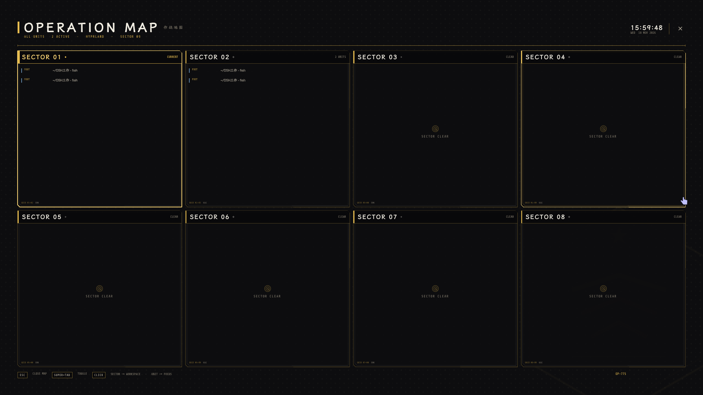 |  |

| 副官設置 | 壁紙 |
| --- | --- |
| 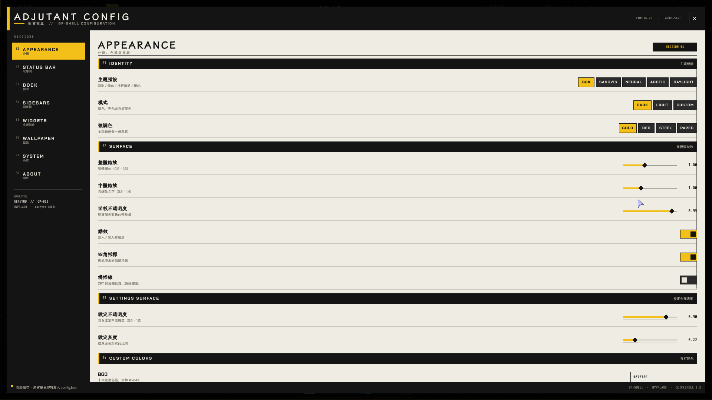 |  |

| 日曆彈出 | OSD | 通訊 |
| --- | --- | --- |
| 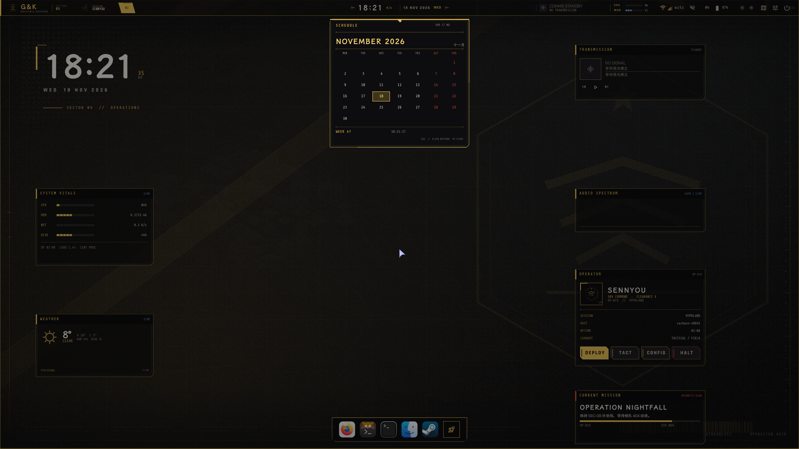 |  |  |

| 左側邊欄 | 右側邊欄 |
| --- | --- |
|  |  |

| English 介面 | 日本語介面 | 日本語側邊欄 |
| --- | --- | --- |
| 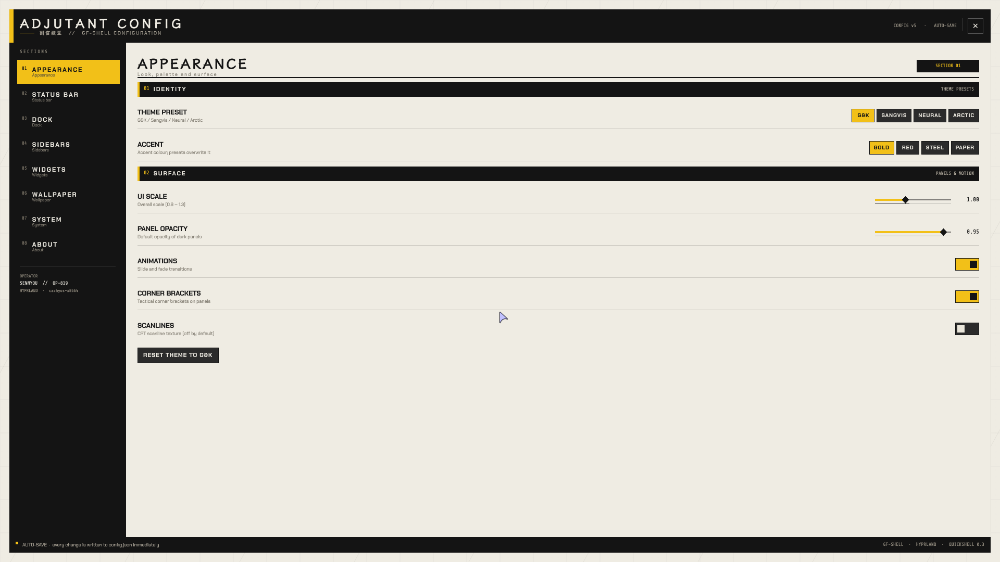 |  |  |

| 組件編輯：狀態列 | 側邊欄組件 | 桌面網格佈局 |
| --- | --- | --- |
|  | 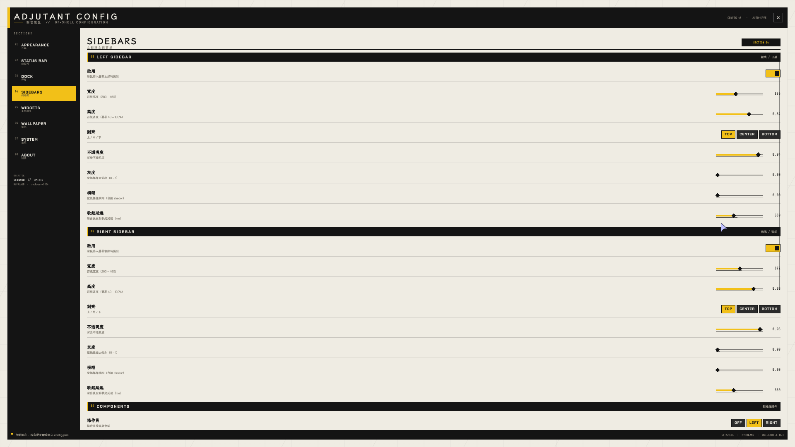 | 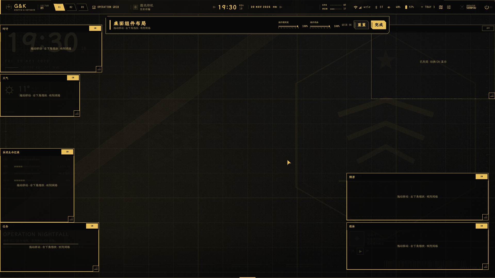 |

| 亮色主題：桌面 | 亮色主題：部署終端 | 設定：縮放與表面 |
| --- | --- | --- |
| 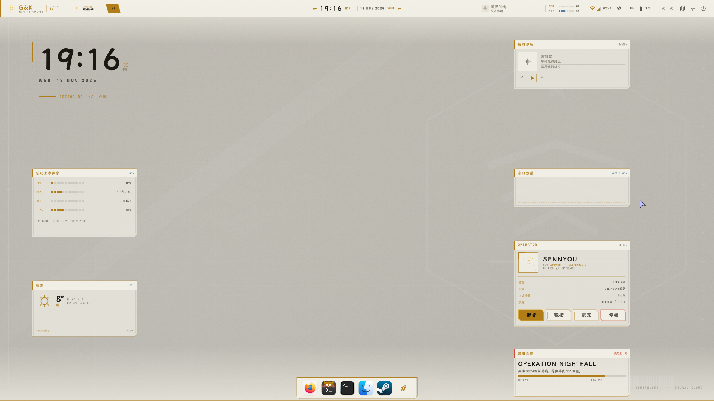 | 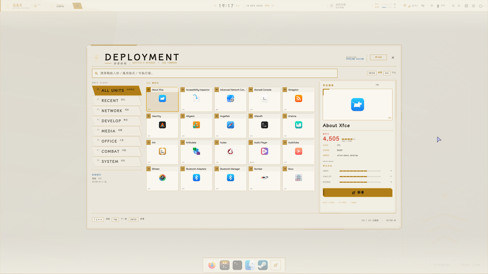 | 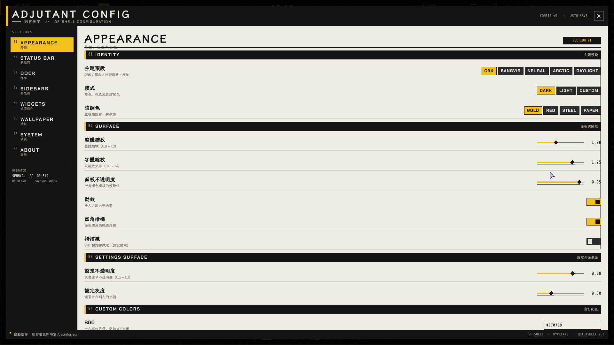 |

| Network details & nearby Wi-Fi | Bluetooth details | Performance details |
| --- | --- | --- |
| 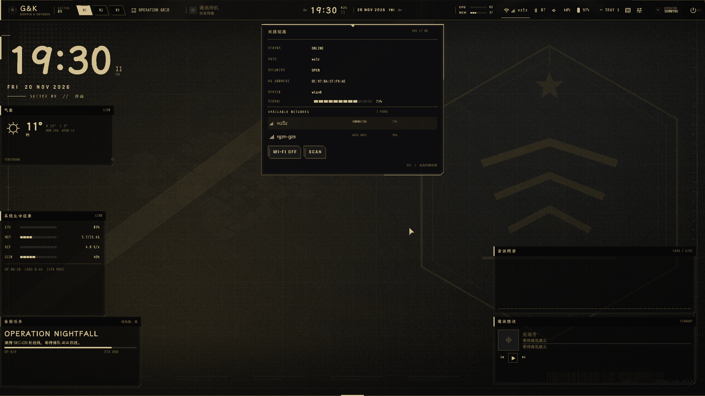 | 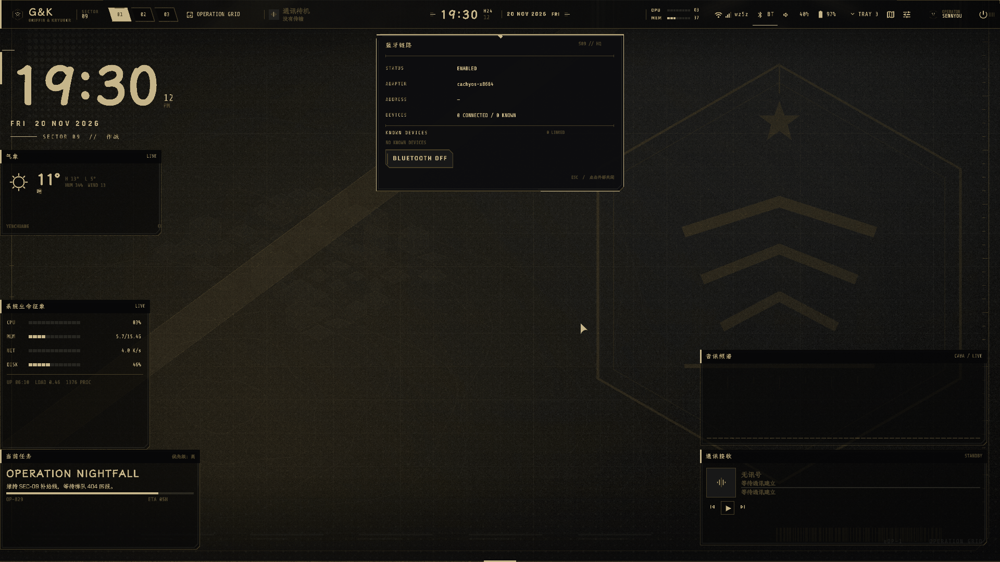 | 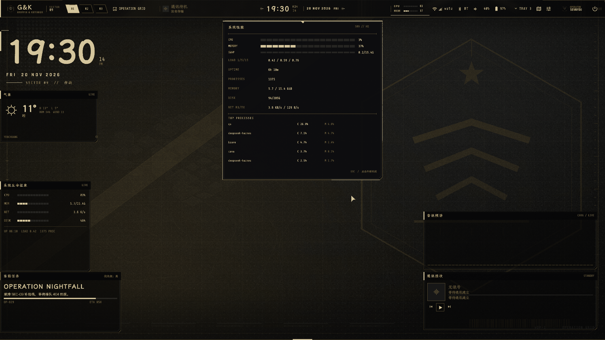 |

| Settings home / avatar | Wallpaper library | Expandable tray |
| --- | --- | --- |
| 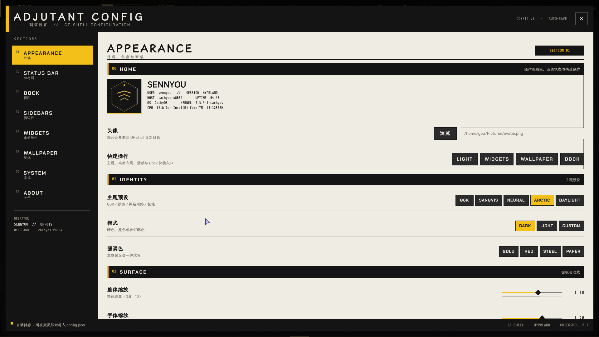 | 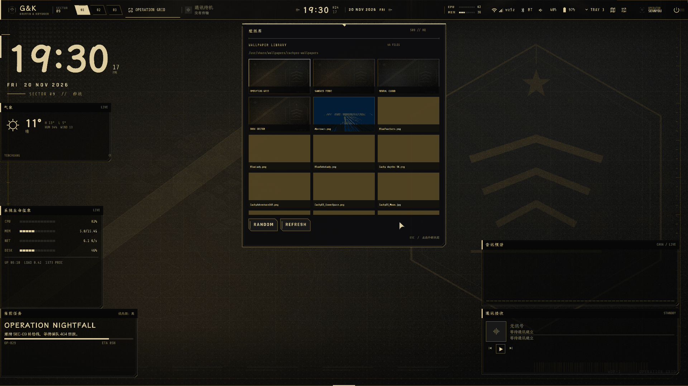 | 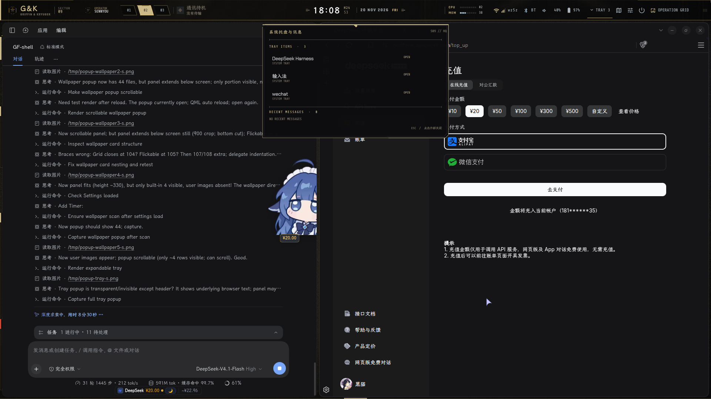 |

| Vertical dock (left) | | |
| --- | --- | --- |
| 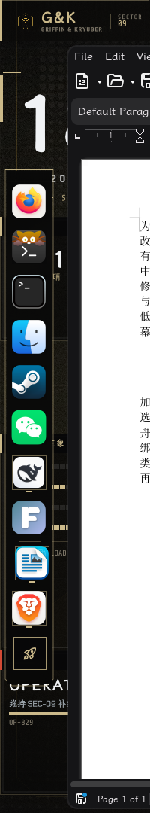 | | |

同一套外殼跑在 **niri** 上（嵌套於 Hyprland 測試的視窗）：


---

## 需求

- **Quickshell ≥ 0.3**（Arch: `quickshell`；Fedora: COPR；Debian 13: `trixie-backports`）
- Qt 6：`qt6-declarative`、`qt6-svg`、`qt6-wayland`、`qt6-base`
- Wayland 合成器：**Hyprland** 或 **niri**（皆已測試）
- 建議工具（缺少時對應功能自動停用）：
  - `pipewire` + `wireplumber`：音量
  - `brightnessctl`：亮度
  - `NetworkManager`：網路開關/SSID
  - `bluez`：藍牙開關
  - `upower`：電池
  - `cava`：音樂頻譜
  - `curl`：天氣（wttr.in）與歌詞（lrclib.net）
  - `grim` / `slurp` / `wf-recorder`：截圖與錄影
  - `wl-clipboard`：截圖複製
- 字型：西文與圖示隨附（`assets/fonts/`）；CJK 使用系統 `Noto Sans CJK`。

---

## 安裝

```bash
git clone <repo> GF-shell           # 或直接使用本目錄
cd GF-shell

# Fedora / Nobara / RHEL 系（自動 COPR + 依賴）
./scripts/install-fedora.sh

# Debian / Ubuntu（Debian 13 自動 backports；沒套件時加 --build-quickshell）
./scripts/install-debian.sh

# Arch / 通用
./install.sh                        # 複製到 ~/.config/quickshell/gf-shell
# 或開發用：
./install.sh --link                 # 符號連結，改檔案即生效

qs -c gf-shell                      # 啟動
```

也可以不安裝，直接指定路徑執行：

```bash
qs -p /path/to/GF-shell
```

解除安裝：

```bash
rm -rf ~/.config/quickshell/gf-shell
rm -rf ~/.config/gf-shell
```

### 開機自啟

**Hyprland**（Lua 設定，0.5x）：

```lua
hl.exec_cmd("qs -c gf-shell")
```

**Hyprland**（傳統 `hyprland.conf`）：

```ini
exec-once = qs -c gf-shell
```

**niri**（`~/.config/niri/config.kdl`）：

```kdl
spawn-at-startup "qs" "-c" "gf-shell"
```

> 若原本使用其他外殼（例如 end4-pC / caelestia / waybar），請先停用它的自啟與狀態列，避免兩條 bar 疊在一起。

---

## 快捷鍵與 IPC

外殼透過 Hyprland 的 global shortcut 註冊（appid `gf-shell`）。在 Hyprland 裡把下列綁定加進設定即可：

```lua
-- Hyprland 0.57 的 Lua 設定
hl.bind("SUPER + Space",      hl.dsp.global("gf-shell:launcher"),  { description = "GF-shell: 部署終端" })
hl.bind("SUPER + ALT + TAB",  hl.dsp.global("gf-shell:overview"),  { description = "GF-shell: 作戰地圖" })
hl.bind("SUPER + SHIFT + TAB", hl.dsp.global("gf-shell:overview"), { description = "GF-shell: overview (alt)" })
hl.bind("SUPER + SHIFT + C",  hl.dsp.global("gf-shell:control"),   { description = "GF-shell: 戰術控制" })
hl.bind("SUPER + SHIFT + P",  hl.dsp.global("gf-shell:power"),     { description = "GF-shell: 系統停機" })
hl.bind("SUPER + SHIFT + W",  hl.dsp.global("gf-shell:widgets"),   { description = "GF-shell: widget layout" })
hl.bind("PRINT",              hl.dsp.global("gf-shell:screenshot"),{ description = "GF-shell: screenshot" })
```

傳統設定：

```ini
bind = SUPER, Space, global, gf-shell:launcher
bind = SUPER ALT, TAB, global, gf-shell:overview
bind = SUPER SHIFT, TAB, global, gf-shell:overview
bind = SUPER SHIFT, C, global, gf-shell:control
bind = SUPER SHIFT, P, global, gf-shell:power
bind = SUPER SHIFT, W, global, gf-shell:widgets
bind = , Print, global, gf-shell:screenshot
```

**niri** 沒有 Hyprland 的 global shortcut 協定，改用 IPC：

```kdl
Mod+Space { spawn "qs" "-c" "gf-shell" "ipc" "call" "shell" "toggle" "launcher"; }
Mod+Alt+Tab { spawn "qs" "-c" "gf-shell" "ipc" "call" "shell" "toggle" "overview"; }
Mod+Shift+Tab { spawn "qs" "-c" "gf-shell" "ipc" "call" "shell" "toggle" "overview"; }
Mod+Shift+W { spawn "qs" "-c" "gf-shell" "ipc" "call" "shell" "widgets"; }
```

> 注意：`SUPER+Tab` 可能被其他 shell（例如 MC-shell）占用；本專案使用 `SUPER+ALT+Tab`。
> 若快捷鍵無作用，先確認 `hyprctl globalshortcuts | grep gf-shell` 含 `gf-shell:overview`，
> 並確認同一組鍵沒有重複綁定（重複會開啟又立刻關閉）。

IPC 介面（`IpcHandler`，target `shell`）：

```bash
qs -c gf-shell ipc call shell toggle launcher    # none|launcher|control|overview|power|settings|calendar
qs -c gf-shell ipc call shell open overview
qs -c gf-shell ipc call shell close
qs -c gf-shell ipc call shell widgets   # 桌面組件佈局編輯
qs -c gf-shell ipc call shell volume 0.7   # 設定音量
qs -c gf-shell ipc call shell mute         # 切換靜音
qs -c gf-shell ipc call shell status
```

| 覆蓋層 | `GF_OVERLAY` 值 | 說明 |
| --- | --- | --- |
| 部署終端 | `launcher` | 搜尋 / 啟動應用 |
| 戰術控制 | `control` | 鏈路、音量、亮度、通訊 |
| 作戰地圖 | `overview` | 工作區與視窗 |
| 系統停機 | `power` | 電源動作 |
| 副官設置 | `settings` | 設定視窗 |
| 日曆 | `calendar` | 行程 |

> 除錯用環境變數：`GF_OVERLAY=<overlay>` 啟動即打開某個覆蓋層；`GF_TAB=<0-7>` 指定設置分頁；
> `GF_DEBUG=osd|toast|gauge|icons` 顯示對應的除錯畫面（`modules/debug/`）。

---

## 設定

設定檔：`~/.config/gf-shell/config.json`（首次啟動自動生成）。

| 區塊 | 常用鍵 |
| --- | --- |
| `bar` | `position`、`thickness`、`opacity`、`gray`、`blur`、`clock24h`、`showSeconds`、`left` / `center` / `right`（組件順序；可在設定裡設 OFF/LEFT/CENTER/RIGHT） |
| `sidebar` | `left` / `right` 的 `width`、`height`（0.4–1.0）、`align`、`opacity`、`gray`、`blur`、`assign.<id>`（left/right/off） |
| `theme` | `preset`（含 `light`）、`mode`（dark/light/custom）、`accent`、`accent2`、`bg0`、`bg1`、`panel`、`text`、`fontScale`、`settingsOpacity`、`settingsGray`、`scale`、`animations` |
| `wallpaper` | `enabled`、`path`（`file://` 或空＝內建）、`fillMode`、`dim` |
| `dock` | `enabled`、`autoHide`、`avoid`、`trigger`（熱區 4–48px）、`iconSize`、`opacity`、`gray`、`blur`、`maxItems`、`pinned` |
| `widgets` | `grid`（吸附像素）、各組件的 `enabled`、`x`、`y`、`width`、`height`（可在佈局編輯器拖右下角縮放） |
| `overview` | `columns`、`desktops`、`backdrop` |
| `notifications` | `dnd`、`toasts`、`maxToasts` |
| `osd` | `enabled` |
| `language` | `auto` / `zh_TW` / `zh_CN` / `en` / `ja` |

`bar.left/center/right` 可用區塊：

```
launcher | emblem | user | workspaces | title | clock | media | stats | net | bluetooth | volume
| battery | tray | overview | control | power
```

任何改動都可以在「副官設置」裡完成，設定會即時寫入。

---

## 目錄結構

```
GF-shell/
├── shell.qml                    # 入口：字型、主題綁定、快捷鍵、每螢幕視窗、IPC
├── install.sh
├── scripts/install-fedora.sh    # Fedora 安裝腳本
├── scripts/install-debian.sh    # Debian / Ubuntu 安裝腳本
├── scripts/gen_assets.py        # 壁紙 / 徽章 / 紋理產生器（Pillow + numpy）
├── assets/
│   ├── fonts/                   # Chakra Petch、Saira Condensed、Rajdhani、Share Tech Mono、GFTacticalIcons
│   ├── icons/                   # emblem*.png（程序生成）
│   ├── textures/                # halftone / hatch / noise / scanlines
│   ├── shaders/                 # glass.frag(.qsb)：面板 blur/desaturate
│   └── wallpapers/              # gfl-ops / gfl-sangvis / gfl-neural / gfl-dusk
├── services/                    # 單例服務層
│   ├── Compositor.qml           # Hyprland + niri 統一工作區/視窗 API
│   ├── Settings.qml             # config.json 讀寫、主題預設
│   ├── Audio / Battery / Net / Media / Notifs / Stats / System / Apps / Capture
│   ├── Lyrics / Weather / Visualizer / User.qml
│   ├── I18n.qml                 # 繁中 / 簡中 / 英文 / 日文
│   └── Wallpapers.qml
├── modules/
│   ├── common/                  # Theme.qml、ShellState.qml、Util.qml
│   │   └── widgets/             # Gf* 設計系統：Frame / Button / Slider / Toggle / Gauge…
│   ├── bar/                     # 狀態列、區塊、日曆、錨定彈出欄（BarPopup）
│   ├── launcher/                # 部署終端
│   ├── control/                 # 戰術控制
│   ├── overview/                # 作戰地圖
│   ├── power/                   # 系統停機
│   ├── widgets/                 # 桌面 HUD
│   ├── dock/                    # 梯隊
│   ├── notifications/           # 通訊彈窗
│   ├── osd/                     # 音量/亮度 HUD
│   ├── wallpaper/               # 桌面底層
│   ├── sidebars/                # 左/右側邊欄 + 11 個可拆裝組件
│   ├── settings/                # 副官設置（紙白/黑線/黃色懸停）
│   └── debug/                   # GF_DEBUG 用的除錯頁
└── docs/                        # 安裝、設定、架構、進度、截圖
```

**資料流**：`services/*` 訂閱系統狀態（Quickshell 的 Pipewire/UPower/Mpris/Networking/SystemTray、`hyprctl` / `niri msg`），
`modules/common/Theme.qml` 提供唯一的設計 token，所有 UI 只讀 `Theme.*` 與服務的唯讀屬性；
狀態機在 `ShellState.qml`，寫入在 `Settings.qml`。

---

## 自訂與換膚

- **顏色 / 間距 / 字級**：只改 `modules/common/Theme.qml`。
- **主題預設**：`services/Settings.qml` 的 `presets`，或直接在設置裡切換。
- **新增狀態列區塊**：
  1. 在 `modules/bar/blocks/` 新增 `FooBlock.qml`；
  2. 在 `modules/bar/BarItem.qml` 的 `switch` 加上 `foo`；
  3. 在設定檔的 `bar.left/center/right` 加入 `"foo"`。
- **新增覆蓋層**：建立 `PanelWindow`（`WlrLayer.Overlay`）→ 依 `ShellState.overlay === "name"` 顯示 →
  在 `shell.qml` 實例化 → `IpcHandler` / `GlobalShortcut` 已支援任意名稱。
- **換壁紙**：在「副官設置 → 壁紙」直接選；也可把圖片路徑寫進 `wallpaper.path`。官方公式圖請自備（專案不散布版權素材），細節見 [設計說明](docs/DESIGN.md)。

---

## 素材生成

```bash
python3 scripts/gen_assets.py
```

需要 `Pillow` 與 `numpy`。會重新產生：

- `assets/wallpapers/*.png`（1920×1080，暖炭底 + 金色斜帶 + 半調網點 + 等高線 + 等距基地線稿 + 徽章水印 + 金色細框）
- `assets/icons/emblem*.png`、`assets/icon.png`
- `assets/textures/*.png`

**徽章是原創設計**（六角框 + 三層翼形雪佛龍 + 指揮星），不是《少女前線》的任何官方標誌。

---

## 雙合成器支援

`services/Compositor.qml` 把兩者的差異收斂成一組 API（`workspaces`、`windows`、`focusedId`、`windowTitle`、
`focusWorkspace()`、`focusWindow()`、`step()`）：

- **Hyprland**：走 Quickshell 的 `Quickshell.Hyprland` 服務（事件驅動）。
  同時處理 Hyprland 0.5x 的 **Lua 設定**（`Hyprland.usingLua` 時改用 `hl.dsp.*` 派發）。
- **niri**：Quickshell 0.3.x 沒有 niri 服務，改用 `niri msg --json` 查詢 + `niri msg event-stream` 當變更信號，
  並保留 3 秒低頻輪詢與事件流斷線重連作為保險。
- 偵測順序：`NIRI_SOCKET` 優先（niri 嵌套在 Hyprland 裡時兩者都會存在），其次 `HYPRLAND_INSTANCE_SIGNATURE`。

---

## 已知限制

- **niri**：不支援 Hyprland 的 global shortcut 協定，`GlobalShortcut` 只會在 Hyprland 生效；niri 請用 IPC 綁定。
- **模糊**：不使用合成器 blur（面板是半透明 + 金線細框），所以在任何合成器上表現一致，也不會拖慢效能。
- **通知**：同一時間只能有一個 `org.freedesktop.Notifications` 服務；若其他外殼已佔用，GF-shell 的通知會等對方退出後才接手。
- **多螢幕**：狀態列、桌面 HUD、梯隊會為每個螢幕各建一份；全螢幕覆蓋層建立在目前聚焦的螢幕上。
- **托盤**：部分程式的 StatusNotifierItem 圖示不標準，會顯示為圓點佔位符。
- **截圖**：依賴 `grim`（Wayland）；`wf-recorder` 用於錄影。

---

## 授權與致謝

- 程式碼：MIT（見 `LICENSE`）。
- 隨附字型：SIL Open Font License 1.1（Chakra Petch、Saira Condensed、Rajdhani、Share Tech Mono）與
  Apache License 2.0（Material Symbols Rounded）；詳見 `assets/fonts/LICENSES.md`。
- 視覺風格為對《少女前線》（Girls' Frontline）**公開介面風格**的致敬與再詮釋；
  本專案不包含、也不散布任何遊戲原始美術素材、標誌或字型。
- 架構上參考了使用者本機的 end4-pC（end-4 dots-hyprland 的 Quickshell 移植）與常見 Quickshell 外殼的服務層做法，
  但所有 UI 與素材皆為本專案重新撰寫 / 生成。
