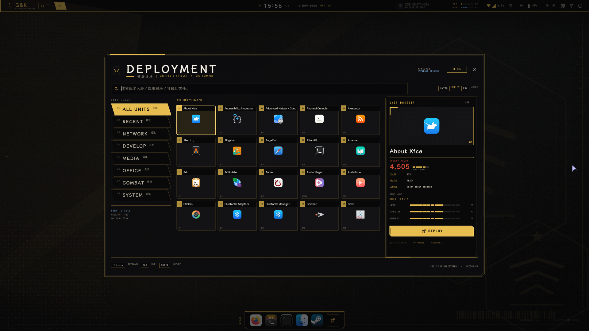
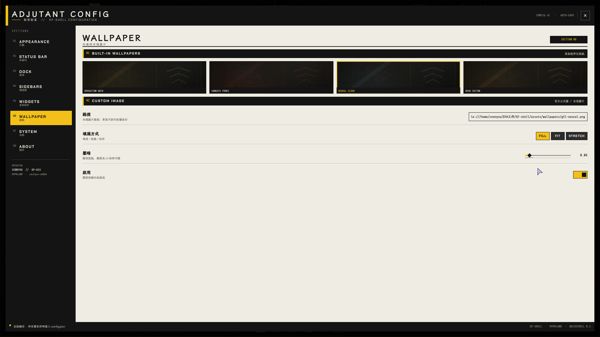
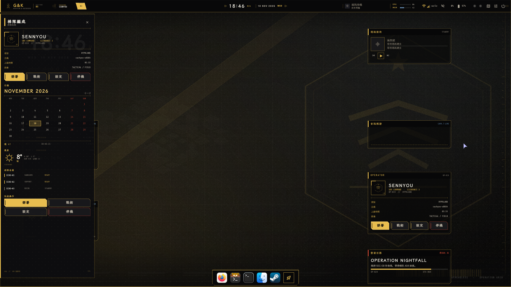
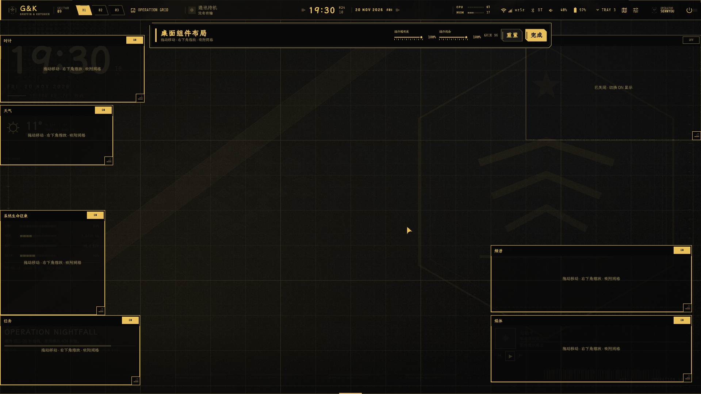
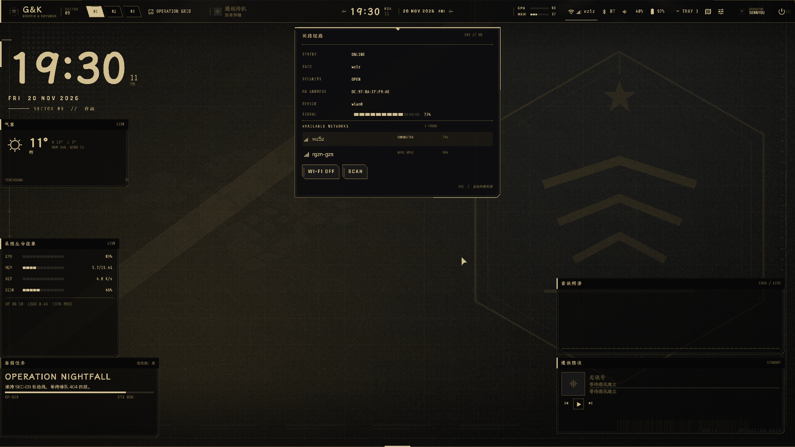
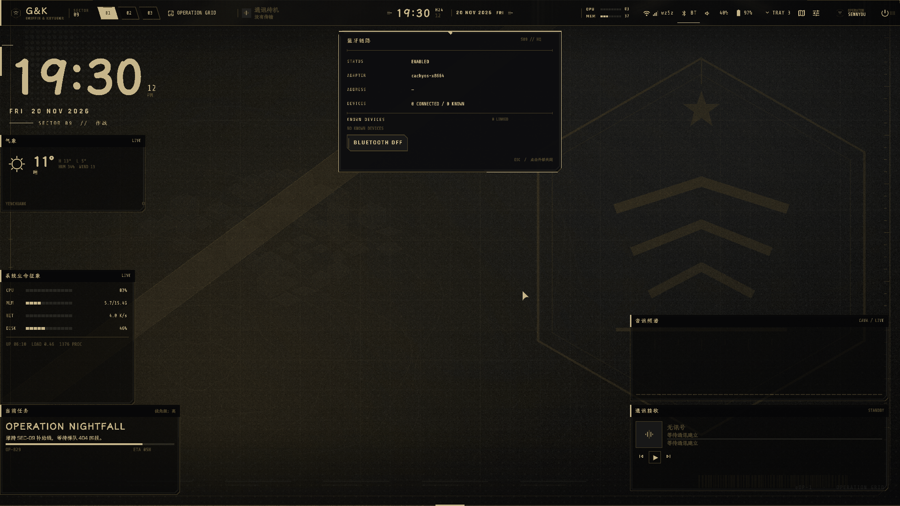
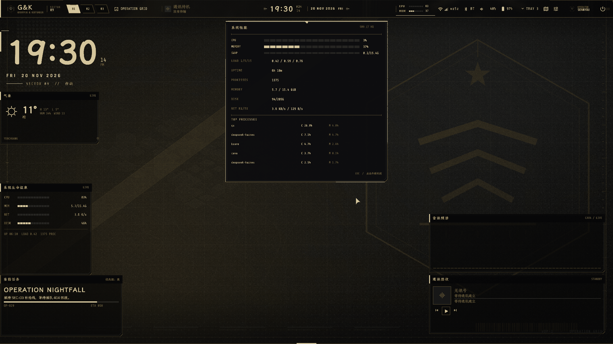
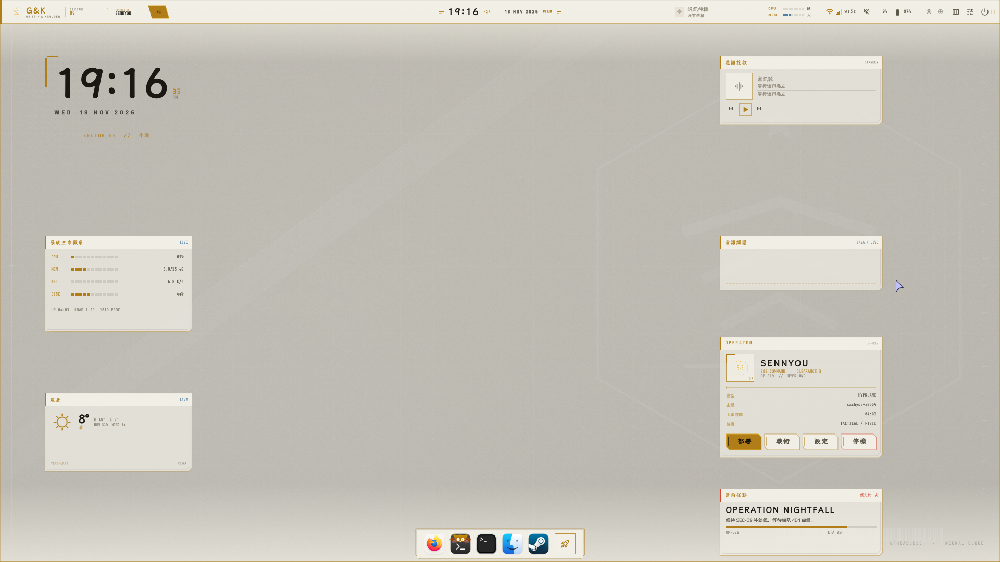
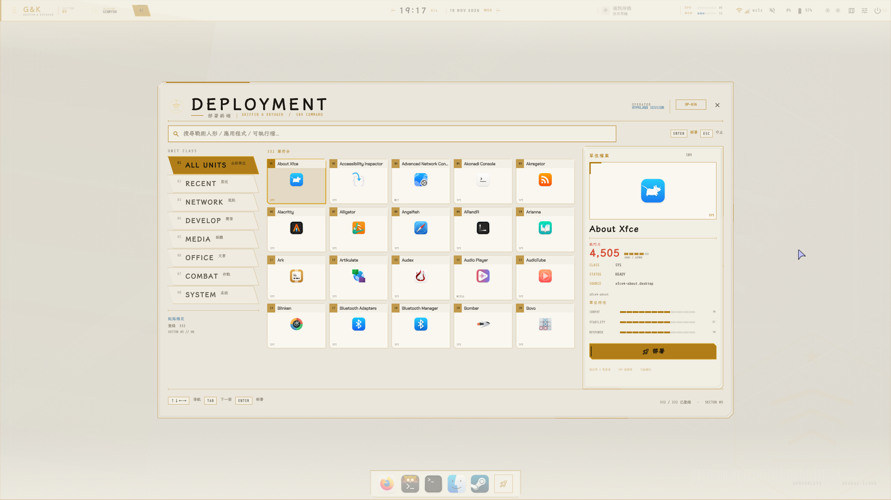
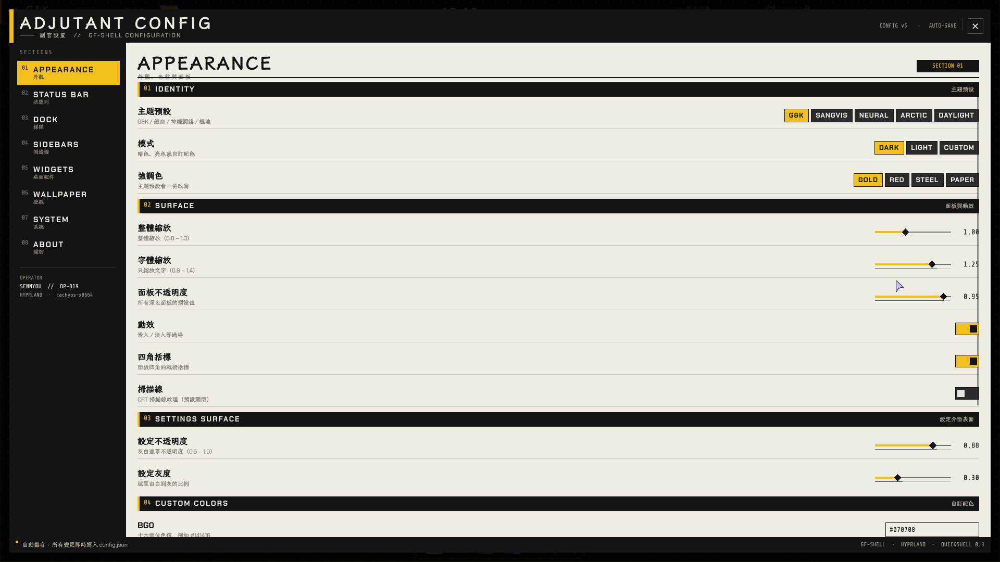

# Progress & screenshots

[繁體中文](PROGRESS.md)

Last updated: 2026-11-18 · config v5 · Quickshell 0.3 / Qt 6

This is the single entry point for "what the shell looks like now, what is done, what is missing".
Every screenshot lives in [`docs/screenshots/`](screenshots/) and can be opened from here.

## Status

| Module | Status | Notes |
| --- | --- | --- |
| Theme & panels | ✅ | Warm charcoal + matte gold; **dark / light / custom** palettes; font and shell scaling; double frames, angled tabs, ribbons, halftone |
| Status bar | ✅ | Per-block OFF / LEFT / CENTER / RIGHT; opacity / grayscale / blur / height / position |
| Bar popups | ✅ | Operator / calendar / media detail panels anchored to the clicked block |
| Launcher | ✅ | Categories, search, keyboard navigation, dossier, combat power |
| Control centre | ✅ | Links, volume/brightness, modules, vitals, comms |
| Operation map | ✅ | Sector cards, unit lists, click to switch/focus |
| System halt | ✅ | Lock / suspend / restart / shutdown / logout + confirmation |
| Dock | ✅ | Pinned + running apps, right-click pin/unpin/close, hot-zone height 4–48 px, exclusive zone pushes windows |
| Sidebars | ✅ | **11 swappable components**, left/right/off assignment, height 40–100%, top/center/bottom, scrolling |
| Desktop widgets | ✅ | Clock, vitals, media (lyrics), weather, cava spectrum, operator card, mission; **grid editor with drag-snap, bottom-right resizing and per-widget ON/OFF** |
| Settings | ✅ | Paper/black rules/charcoal buttons/yellow hover; **translucent gray-white background with adjustable opacity/gray**; 8 tabs; live save |
| Languages | ✅ | 繁中 / 简中 / English / 日本語; `auto` follows the system; live switch |
| Lyrics | ✅ | lrclib.net synced lyrics shared by media card / sidebar / popup |
| Weather | ✅ | wttr.in, 20-minute polling, optional city |
| Spectrum | ✅ | cava (shows NO AUDIO when unavailable) |
| Compositors | ✅ | Tested on Hyprland and niri |
| Official art | ⛔ | Not bundled; point `wallpaper.path` at your own copy |

## Recent work

- **Sidebar components**: operator, calendar, roster, quick actions, vitals, weather, clock,
  media, visualizer, comms, mission — 11 components, each assignable to left / right / off in
  Settings → Sidebars → Components.
- **Sidebar height & alignment**: `sidebar.<side>.height` (0.4–1.0) and `align`
  (top/center/bottom); the panel scrolls when the components do not fit, with a pinned scrollbar.
- **Bar component editor**: every block can be OFF / LEFT / CENTER / RIGHT; the editor rewrites
  `bar.left` / `bar.center` / `bar.right`.
- **Four UI languages**: all new settings pages, sidebars, popups, HUD, media cards and lyric
  states go through `I18n.t()`.
- **Media buttons**: hand-drawn play/pause glyphs, independent of icon-font coverage.
- **Settings window** now follows the focused monitor, so it no longer opens on the wrong output.
- **Desktop layout editor**: `SUPER+SHIFT+W`, Settings → Layout, or IPC `shell widgets`; grid overlay, drag-to-snap, bottom-right resizing and a per-widget ON/OFF button.
- **Dock hot zone**: `dock.trigger` 4–48 px, adjustable in Settings → Dock; a wider gold handle marks the hidden area.
- **Dock apps**: running apps are appended after pinned entries; right-click offers pin/unpin, new window and close, with the pinned list saved to `dock.pinned`.
- **Status bar details**: the network block opens link details and nearby connectable Wi-Fi (open networks connect directly, WPA asks for a password); Bluetooth is a separate block with details; CPU/MEM stats open a performance panel.
- **Overview move**: drag a unit row onto another sector (or right-click then click a sector); `Compositor.moveWindow()` moves it. Two shortcuts: `SUPER+ALT+Tab` and `SUPER+SHIFT+Tab`.
- **Volume**: the default sink is now read/written through `wpctl`, fixing empty Quickshell `channelVolumes` on some WirePlumber setups; IPC `volume` / `mute` added.
- **Cross-distro install**: `scripts/install-fedora.sh` (dnf, COPR, optional source build) and `scripts/install-debian.sh` (apt, trixie-backports, optional source build), with `--dry-run`/`--link`/`--dest`/`--yes`.
- **Widget sizes**: `widgets.<name>.width/height` resize freely and snap to the grid.
- **Themes & scaling**: new `DAYLIGHT OPS` light preset, DARK/LIGHT/CUSTOM modes, custom BG0/BG1/PANEL/TEXT/ACCENT colours; separate `SHELL SCALE` and `FONT SCALE`; the settings veil has adjustable opacity/gray.

## Screenshots

### Desktop & main surfaces

| Desktop | Launcher |
| --- | --- |
|  |  |

| Control centre | Operation map |
| --- | --- |
|  |  |

| System halt | Settings (appearance) |
| --- | --- |
|  |  |

| Settings (wallpaper) | Calendar popup |
| --- | --- |
|  |  |

| OSD | Notifications |
| --- | --- |
|  |  |

### Sidebars & component editors

| Left sidebar (default components) | Right sidebar (media / spectrum / comms) |
| --- | --- |
|  |  |

| Bar component editor | Sidebar components / height |
| --- | --- |
|  |  |

| Desktop grid layout editor |
| --- |
|  |

### Theme & scaling

| Network details & nearby Wi-Fi | Bluetooth details | Performance details |
| --- | --- | --- |
|  |  |  |

| Light theme: desktop | Light theme: launcher | Settings: scale & surface |
| --- | --- | --- |
|  |  |  |

### Languages

| English | Japanese |
| --- | --- |
|  |  |

| Japanese sidebar | niri |
| --- | --- |
|  |  |

## Verification

- **Hyprland 0.57**: headless 1920×1080 load and capture; `Configuration Loaded`, no QML errors.
- **niri**: nested window (~648×501), backend reports `NIRI`, operation map switches to 2 columns.
- **Languages**: English / Japanese / Simplified Chinese / Traditional Chinese launched separately;
  settings and sidebar strings switch correctly.
- **Sidebar sizes**: 0.55 (center), 0.72 (center), 0.82/0.88 (top); scrolling and alignment work.
- **Bar**: clock left, workspaces centre, media/volume/power right; reordering takes effect immediately.

## Known limitations

- Lyrics and weather need network access and `curl`; missing data shows `NO DATA` / `NO LINK`.
- The spectrum needs `cava` and a working PipeWire source.
- "Blur" is a wallpaper-sampling shader inside the panel, not compositor-level blur; it also works on niri.
- Notification forwarding depends on `org.freedesktop.Notifications`; if another daemon owns it, that
  daemon handles notifications.
- Official promotional art, game art and paid asset packs are not distributed; point `wallpaper.path`
  at your own copy.
