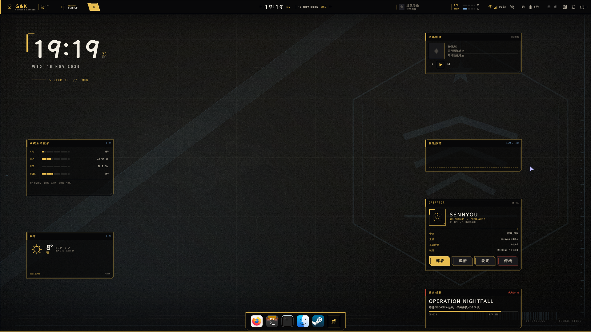
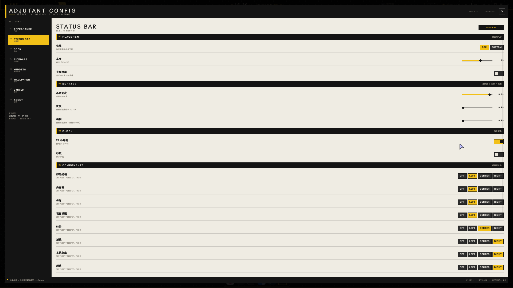
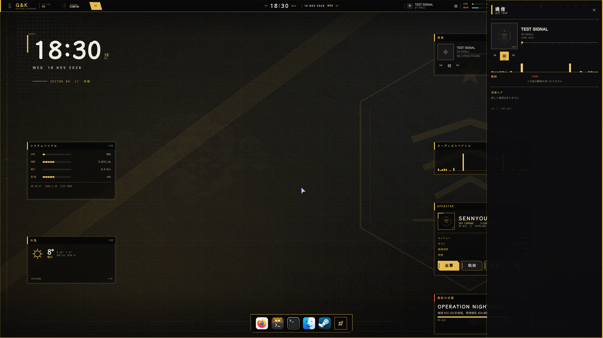

# 開發進度與截圖

[English](PROGRESS.en.md)

最後更新：2026-11-18 · 對應 `config` v5 · Quickshell 0.3 / Qt 6

這份文件是外殼的「目前長什麼樣、做到哪裡、還缺什麼」的單一入口；所有截圖都在
[`docs/screenshots/`](screenshots/)，並且可以從這裡直接點開。

## 狀態總覽

| 模組 | 狀態 | 說明 |
| --- | --- | --- |
| 主題與面板 | ✅ | 暖炭黑 + 啞光金；**暗色 / 亮色 / 自訂**配色；字體與整體縮放；雙層框、斜切頁籤、緞帶、網點 |
| 狀態列 | ✅ | 可自訂組件（OFF / LEFT / CENTER / RIGHT）、透明度 / 灰度 / 模糊 / 高度 / 位置 |
| 狀態列彈出 | ✅ | 操作員 / 日曆 / 媒體三個詳細欄，錨定被點擊的組件位置 |
| 部署終端 | ✅ | 分類、搜尋、鍵盤導航、單位檔案、戰鬥力 |
| 戰術控制 | ✅ | 鏈路、音量/亮度、模組、生命徵象、通訊 |
| 作戰地圖 | ✅ | 扇區卡、單位列表、點擊切換/聚焦 |
| 系統停機 | ✅ | 鎖定/休眠/重啟/關機/登出 + 二次確認 |
| Dock | ✅ | 有視窗時收起、熱區展開、exclusive zone 推開視窗 |
| 側邊欄 | ✅ | **11 個可拆裝組件**、左/右/OFF 分配、高度 40–100%、上/中/下對齊、滾動 |
| 桌面組件 | ✅ | 時計、生命徵象、通訊（歌詞）、天氣、cava 頻譜、操作員卡、任務；**網格佈局編輯 + 拖動吸附 + 單獨開關** |
| 設定介面 | ✅ | 紙白/黑線/黑灰按鈕/黃色懸停；**灰白背景可調透明度/灰度**；8 分頁；即時寫入 |
| 多語言 | ✅ | 繁中 / 簡中 / English / 日本語；`auto` 跟隨系統；設定內即時切換 |
| 歌詞 | ✅ | lrclib.net 同步歌詞，媒體卡 / 側邊欄 / 彈出欄共用 |
| 天氣 | ✅ | wttr.in，20 分鐘輪詢，可指定城市 |
| 音樂頻譜 | ✅ | cava（缺少時顯示 NO AUDIO） |
| 雙合成器 | ✅ | Hyprland 與 niri 皆已載入測試 |
| 官方素材 | ⛔ | 不打包；可用 `wallpaper.path` 指向自備圖片 |

## 最近完成

- **側邊欄組件化**：操作員、日曆、梯隊名冊、快捷操作、生命徵象、天氣、時計、媒體、頻譜、
  通訊紀錄、任務，共 11 個；可在「設定 → 側邊欄 → COMPONENTS」逐項分配到左/右或關閉。
- **側邊欄高度與對齊**：`sidebar.<side>.height`（0.4–1.0）與 `align`（top/center/bottom），
  內容超出時可滾動，並有固定滾動條。
- **狀態列組件編輯**：每個區塊可設 OFF / LEFT / CENTER / RIGHT，直接改寫
  `bar.left` / `bar.center` / `bar.right`。
- **四語系 UI**：所有新設定頁、側邊欄、彈出欄、HUD、媒體卡與歌詞狀態都已接入 `I18n.t()`。
- **媒體按鈕**：自繪播放/暫停符號，不再依賴圖示字型缺字。
- **設定視窗**：改為跟隨目前聚焦的螢幕，多螢幕下不會開到錯誤輸出。
- **桌面佈局編輯**：`SUPER+SHIFT+W` / 設定 → LAYOUT / IPC `shell widgets`；疊加網格、拖動吸附、每個組件右上角 ON/OFF。
- **主題與縮放**：新增 `DAYLIGHT OPS` 亮色預設、DARK/LIGHT/CUSTOM 模式、BG0/BG1/PANEL/TEXT/ACCENT 自訂色；`SHELL SCALE` 與 `FONT SCALE` 分離；設定背景灰白遮罩可調透明度/灰度。

## 截圖

### 桌面與主要介面

| 桌面 | 部署終端 |
| --- | --- |
|  |  |

| 戰術控制 | 作戰地圖 |
| --- | --- |
|  |  |

| 系統停機 | 設定（外觀） |
| --- | --- |
|  |  |

| 設定（壁紙） | 日曆彈出 |
| --- | --- |
|  |  |

| OSD | 通訊通知 |
| --- | --- |
|  |  |

### 側邊欄與組件編輯

| 左側邊欄（預設組件） | 右側邊欄（媒體 / 頻譜 / 通訊） |
| --- | --- |
|  |  |

| 狀態列組件編輯 | 側邊欄組件 / 高度編輯 |
| --- | --- |
|  |  |

### 多語言

| English | 日本語 |
| --- | --- |
|  |  |

| 日本語側邊欄 | niri |
| --- | --- |
|  |  |

## 驗證方式

- **Hyprland 0.57**：headless 1920×1080 載入、截圖；`Configuration Loaded`、無 QML 錯誤。
- **niri**：嵌套視窗（約 648×501）載入，後端顯示 `NIRI`，作戰地圖自動切 2 欄。
- **語言**：English / 日本語 / 简体中文 / 繁體中文 分別啟動，設定頁與側邊欄文案切換正常。
- **側邊欄尺寸**：0.55（center）、0.72（center）、0.82/0.88（top）三種形態；滾動與對齊正常。
- **狀態列**：自訂時鐘在左、工作區在中、媒體/音量/電源在右，重排立即生效。

## 已知限制

- 歌詞與天氣需要網路與 `curl`；無資料時顯示 `NO DATA` / `NO LINK`。
- 音樂頻譜需要 `cava` 與可用的 PipeWire 來源。
- 「模糊」是面板內的壁紙採樣 shader，不是合成器層級的 blur；niri 上也能運作。
- 通知轉發依賴 D-Bus 的 `org.freedesktop.Notifications`；若其他通知常駐程式已註冊，會由其處理。
- 官方公式圖、遊戲原畫與付費素材不隨專案散布；請用 `wallpaper.path` 指向自備檔案。
