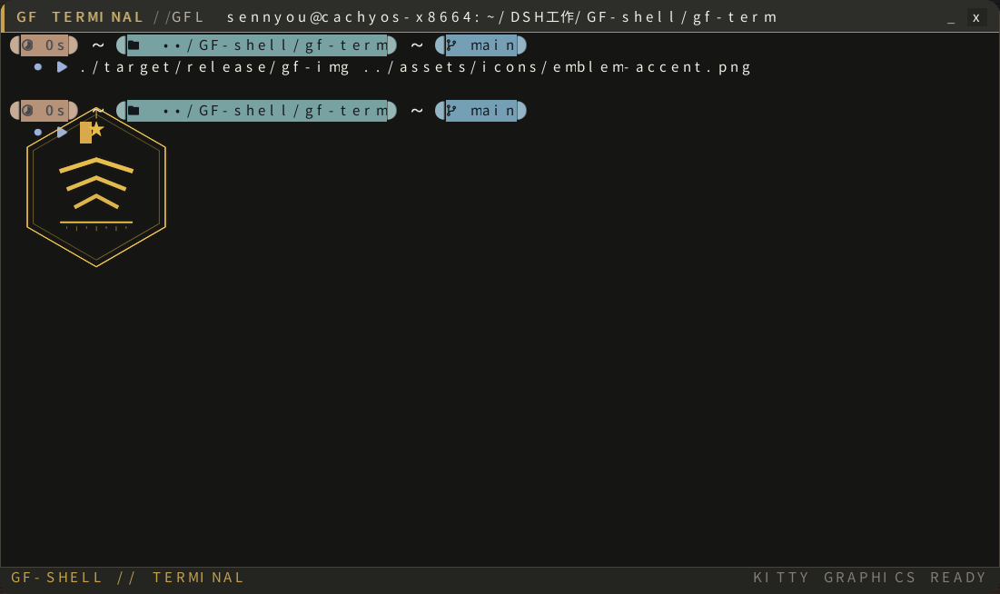

# GF TERMINAL

A small Rust terminal built for **GF-shell**, with its own title bar, the current
GF-shell palette, and **native Kitty-style image output**.



A self-contained HTML introduction is available at [docs/index.html](docs/index.html).

## Why this terminal

- Reads `~/.config/gf-shell/config.json` and uses the active GF-shell palette,
  accent, monospace font and family name.
- Custom GF-style title bar: charcoal/brass frame, live shell title, close and
  minimise controls, draggable header.
- `Ctrl+Shift+R` reloads the GF-shell theme without restarting the shell.
- Truecolor ANSI/256 colour terminal, wide CJK characters, scrollback, wheel
  scrolling, cursor, bold/italic/underline/reverse attributes.
- **Native image output**: implements the Kitty graphics APC protocol directly,
  including base64 PNG and raw RGB/RGBA transmission. There is no Sixel
  dependency and no external image viewer.
- Ships with `gf-img`, a tiny helper that prints a Kitty graphics sequence for
  any PNG/JPEG/GIF/WebP file. It also works in Kitty, Ghostty and other
  Kitty-graphics terminals.

## Build

Requirements:

- Rust 1.80+ (edition 2021)
- Wayland and/or X11 development libraries
- `fontconfig` + `freetype2`
- `libxkbcommon` (Wayland)
- a system monospace font; Nerd Fonts are recommended for glyph-heavy prompts

Arch Linux example:

```bash
sudo pacman -S --needed rust wayland libxkbcommon fontconfig freetype2
```

Build:

```bash
git clone https://github.com/Wglly/GF-shell.git
cd GF-shell/gf-term
cargo build --release
```

## Install

Local user install:

```bash
cd gf-term
./install.sh
```

The script builds release binaries and installs:

- `~/.local/bin/gf-term`
- `~/.local/bin/gf-img`
- `~/.local/share/applications/gf-term.desktop`

Make sure `~/.local/bin` is in `PATH`.

Manual install:

```bash
install -Dm755 target/release/gf-term ~/.local/bin/gf-term
install -Dm755 target/release/gf-img ~/.local/bin/gf-img
```

## Run

```bash
gf-term
```

Optional:

```bash
gf-term --font-size 16
```

The shell is taken from `$SHELL` (falling back to `/bin/sh`). The window has a
custom title bar instead of client-side decorations:

- drag the header to move the window
- `×` closes
- `_` minimises
- `Ctrl+Shift+R` reloads the GF-shell theme
- mouse wheel scrolls back through history

## Images

Inside `gf-term`, run:

```bash
gf-img ~/Pictures/screenshot.png
```

The image is placed at the current cursor cell using the Kitty graphics
protocol. The helper converts any supported input (PNG/JPEG/GIF/WebP) to PNG,
then streams base64 chunks with `a=T,f=100`.

It also works in other Kitty-compatible terminals:

```bash
gf-img wallpaper.webp
```

The terminal accepts the Kitty protocol directly, including chunked transfers
(`m=1`), PNG (`f=100`), raw RGB (`f=24`) and raw RGBA (`f=32`).

## Theme

The terminal reads these fields from `~/.config/gf-shell/config.json`:

| Field | Use |
| --- | --- |
| `theme.bg0` | window background |
| `theme.panel` / `theme.panelAlt` | title bar / footer |
| `theme.lineBright` | brass rule |
| `theme.accent` | cursor, progress, active controls |
| `theme.text` / `textDim` | text |
| `fonts.mono` | terminal font family |

If the file is absent, the GFL charcoal/brass palette is used. Set
`GF_TERM_CONFIG` to use a different config file.

## Current scope

This is a focused terminal, not a clone of Alacritty or Kitty:

- VT/ANSI coverage is broad but not exhaustive (alternate screen, scroll
  regions, SGR, cursor/erase, wide chars and common modes are implemented).
- No text selection/clipboard or mouse-reporting modes yet.
- Kitty graphics is implemented at the transmit/place level; animation,
  source-rectangle cropping and image deletion commands are not yet covered.
- Images are anchored to terminal rows and scroll with the grid; scrollback
  display keeps text history.

## Project layout

```
gf-term/
├── src/main.rs        winit app, input, PTY wiring
├── src/terminal.rs    grid, VTE performer, ANSI/CSI handling
├── src/render.rs      CPU framebuffer, fontdue glyphs, theme chrome
├── src/kitty.rs       APC splitter + Kitty graphics parser
├── src/pty.rs         portable-pty session
├── src/theme.rs       GF-shell config/palette loader
├── src/bin/gf-img.rs  image-to-Kitty helper
└── install.sh
```
